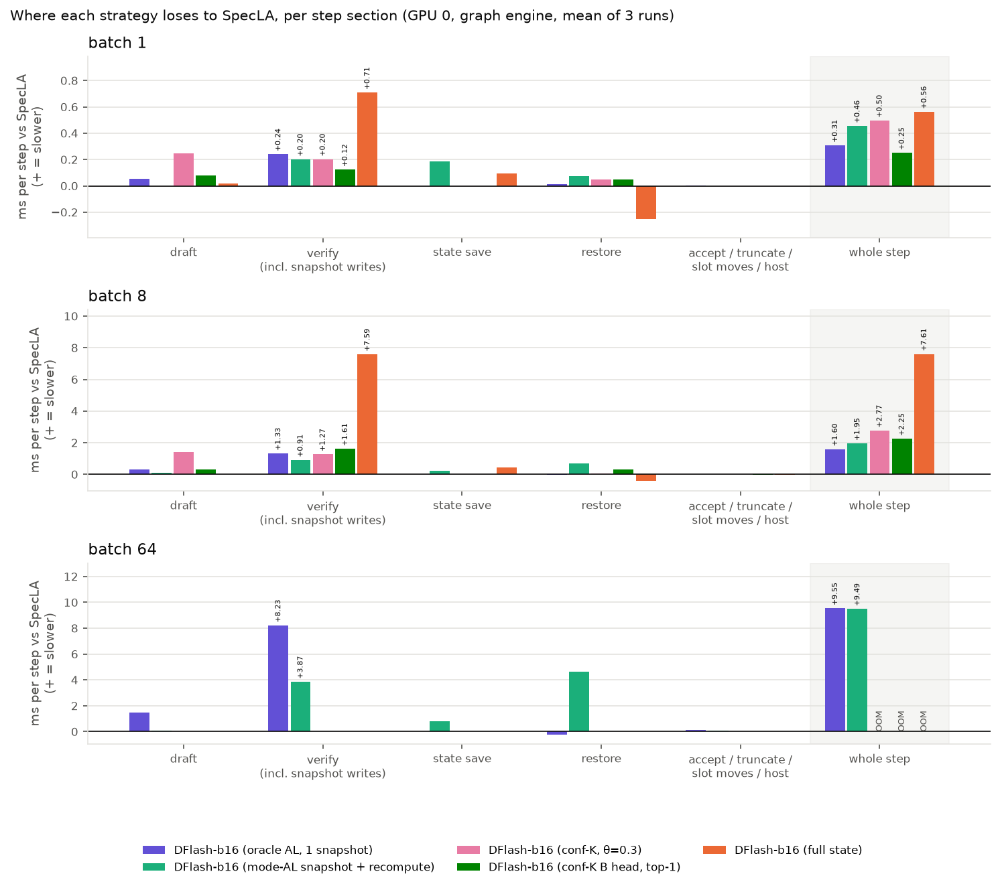
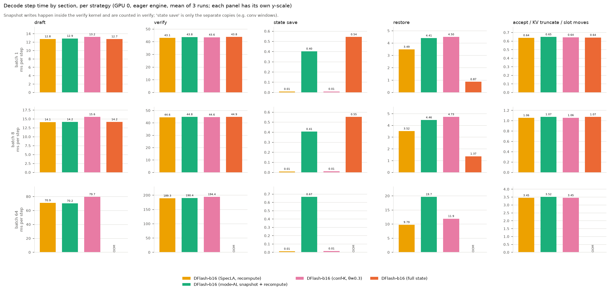
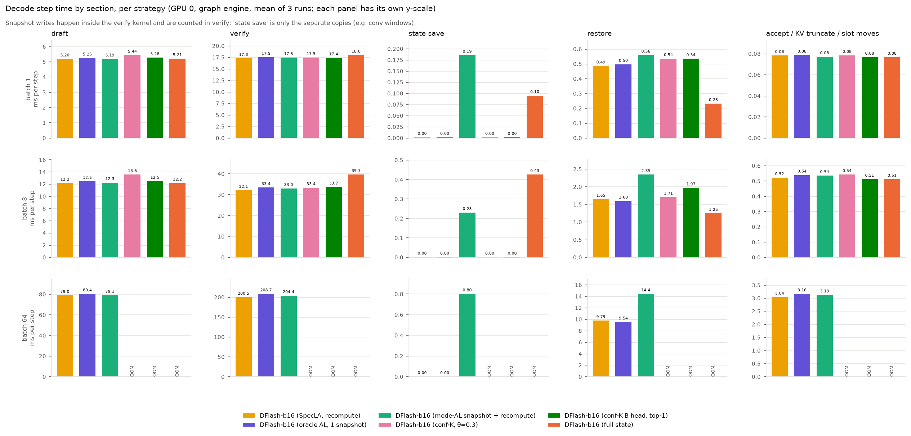
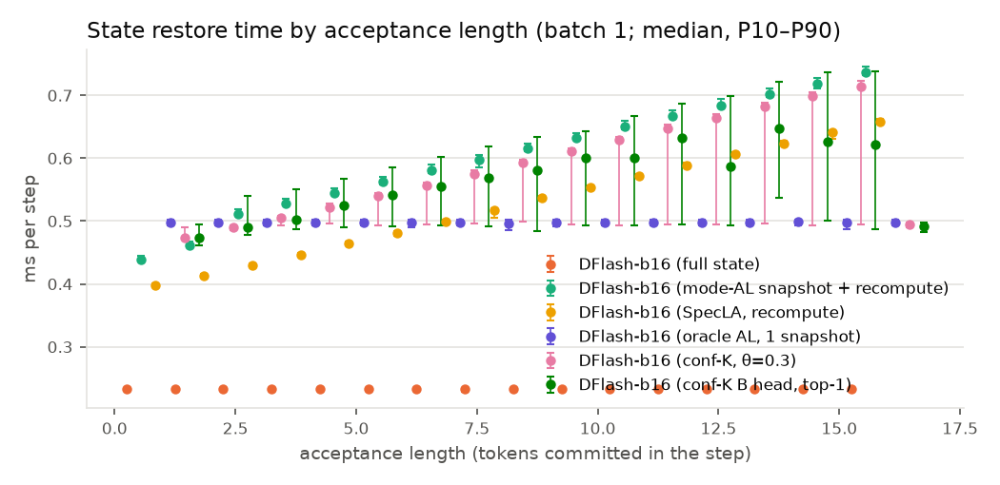
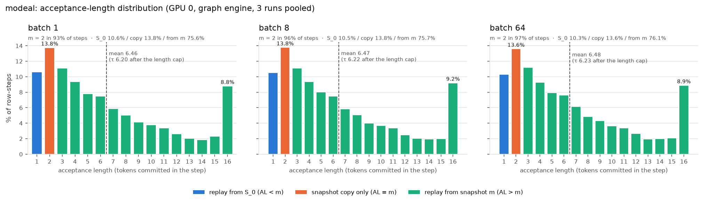
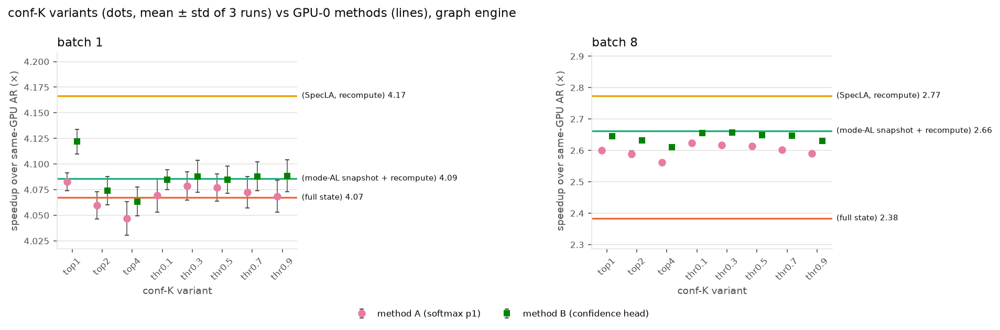
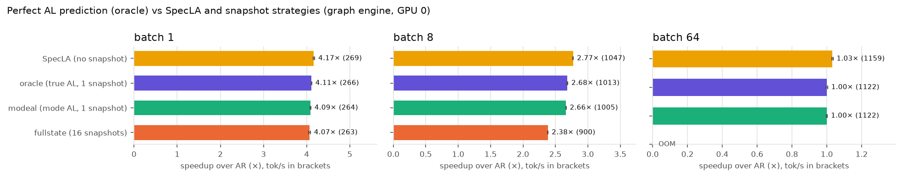

# DFlash GDN 롤백 실험 종합 보고서 — Qwen3.5-4B, RTX 3090, GSM8K-256

지금까지 시도한 실험을 한곳에 모으고, 결과가 왜 그렇게 나왔는지 원인을 정리했습니다. 처음 보고서(eager 엔진 결과)의 원본은 `report_v1_eager.md`에 남아 있습니다.

| 부 | 내용 | 결과 폴더 |
|---|---|---|
| 1부 | HF eager 엔진에서 롤백 방식 4가지 비교 | `results_fullstate/`, `results_{modeal,specla,confk_*}/` |
| 2부 | 같은 실험을 CUDA graph 엔진으로 다시 측정 | `results_graph_*/`, `results_compare_graph/` |
| 3부 | 저장 위치를 하나만 고른다면 어디가 좋은가 (modeal 분석) | `results_compare_graph/plots/modeal_al_hist.png` |
| 4부 | conf-K 방법 B: confidence를 학습한 head로 바꾸기 | `results_graph_confkb_*/` |
| 5부 | oracle: 수락 길이를 완벽하게 안다면 | `results_graph_oracle/` |
| 6부 | DDTree(트리 drafter) 실행 | `results_ext_ddtree_tree_fullstate/`, `results_ext_chain_specla/` |
| 7부 | 저장하는 값 비교: SpecLA와 ReplaySSM | (문헌·코드 비교) |
| 8부 | 동시 요청이 많을 때 SD가 약해지는 이유와 해결 방향 | (측정값으로 계산) |

## 한눈에 보기

1. **롤백 방식은 출력을 바꾸지 않습니다.** 같은 엔진 안에서는 모든 롤백 방식·반복 실행의 출력이 256문항 모두 같습니다(eager 39회, CUDA graph 60회). 복원한 State도 같은 입력으로 다시 계산한 값과 오차 0입니다.
2. **eager 엔진에서는 fullstate가 가장 빨랐습니다**(batch 1에서 AR의 4.68배). 하지만 CPU가 GPU에 일을 시키는 시간에 다른 비용이 가려진 결과였습니다.
3. **실제 서빙에 가까운 CUDA graph 엔진에서는 SpecLA(저장 없이 다시 계산)가 가장 빠릅니다.**
   - batch 1: SpecLA 269 tok/s(AR의 4.17배) > oracle 266 > modeal 264 > fullstate 263
   - batch 8: SpecLA 1047 tok/s(2.77배) > oracle 1013 > modeal 1005 > conf-K 967~1003 > **fullstate 900(2.38배)**
4. **수락 길이를 완벽하게 알아도(oracle) SpecLA를 이기지 못합니다.** 정답 위치 한 칸만 저장해 적중률 100%를 만들었지만 SpecLA보다 1~3% 느렸습니다. 14%만 맞히는 modeal과도 1% 안쪽 차이입니다. **예측 정확도가 아니라 State 저장본을 두는 비용 자체가 걸림돌입니다.**
5. **그래서 예측을 개선하는 방향(modeal 위치 조정, conf-K, 학습한 head)은 graph 엔진에서 이득이 없습니다.** conf-K 방법 B는 예측이 덜 맞는데도 softmax가 빠져서 방법 A보다 1~2% 빨랐습니다.
6. **DDTree는 같은 엔진의 보통 DFlash보다 11% 빠르지만, 엔진 차이가 더 큽니다.** 동료 엔진(eager)에서 batch 1 AR의 4.58배(113 tok/s)였습니다. 대신 시퀀스당 774 MiB가 들어 batch 64부터 메모리 부족이고, 우리 graph 엔진의 SpecLA가 이보다 2.4배 빠릅니다.
7. **동시 요청이 많으면 SD 자체의 이득이 사라집니다.** batch 64에서 SpecLA가 AR의 1.03배, batch 128은 모든 DFlash가 메모리 부족입니다. 검증한 토큰 16개 중 평균 6.2개만 확정되기 때문입니다.

---

## 원인 분석 — 왜 이런 결과가 나왔나

### 원인 1. eager 엔진에서는 "GPU에 일을 시키는 횟수"가 속도를 정했다

- eager 실행은 Python(CPU)이 GPU 작업(커널)을 하나씩 지시합니다. 한 스텝에 커널 수천 개를 지시하는 동안 GPU는 대부분 놀고 있습니다.
- 그래서 **검증 토큰이 16개든 1개든 시간이 비슷했고**, DFlash가 AR보다 4.4~4.7배 빨랐습니다.
- **복원 시간도 다시 계산하는 토큰 수와 상관없이 일정했습니다**(batch 1 스텝당 fullstate 0.87ms, SpecLA 3.5ms, modeal 4.4ms, conf-K 4.7ms). 커널을 적게 띄우는 fullstate(층마다 복사 2번)가 가장 빨랐고, 다시 계산을 줄이려고 커널을 더 띄운 modeal·conf-K가 오히려 느렸습니다.
- **fullstate의 진짜 비용은 숨어 있었습니다.** 16개 위치의 State를 쓰는 데 batch 8에서 스텝당 GPU 7.6ms가 들었지만(보정 측정), CPU를 기다리는 사이에 끝나서 실제 시간에는 드러나지 않았습니다(verify 29.7초 대 SpecLA 29.5초).

### 원인 2. CUDA graph 엔진에서는 "State를 메모리로 옮기는 양"이 속도를 정한다

- CUDA graph는 한 스텝을 통째로 녹화해 재생하므로 지시 시간이 사라집니다. 그러면 남는 비용은 **메모리를 읽고 쓰는 양**입니다.
- Qwen3.5-4B의 GDN State는 층마다 시퀀스당 **2 MiB**(32 head × 128 × 128 × fp32), 24층이면 **48 MiB**입니다. 모델의 다른 값에 비해 매우 큽니다.
- 방식별로 한 스텝에 시퀀스당 State를 몇 번 더 읽고 쓰는지 세면 순위가 그대로 설명됩니다(검증이 S_0을 읽는 것은 모든 방식이 같아서 뺐습니다).

| 방식 | 검증 중 추가로 쓰는 State | 복원에서 읽고 쓰는 State | 합계 (1칸 = 48 MiB) | batch 8 tok/s |
|---|---|---|---|---|
| SpecLA | 0칸 | 2칸 (S_0 읽기 + 결과 쓰기, 그 외 작은 값) | **2칸** | **1047** |
| oracle, modeal | 1칸 | 2칸 (저장본 읽기 + 결과 쓰기) | 3칸 | 1013, 1005 |
| conf-K (저장 2~5칸) | 2~5칸 | 2칸 | 4~7칸 | 967~1003 |
| fullstate | 16칸 | 2칸 (복사) | 18칸 | 900 |

- 실측도 같습니다. batch 8에서 검증 시간이 SpecLA보다 oracle은 +1.3ms, conf-K는 +1.3~2.4ms, fullstate는 +7.6ms 깁니다. 반면 복원 시간은 거의 같습니다(SpecLA 1.65ms, oracle 1.60ms).
- **다시 계산하는 비용은 작습니다.** batch 1에서 토큰당 약 17µs, 평균 6.2토큰이면 약 0.1ms로 스텝(23ms)의 0.5%입니다. 저장본은 이 작은 계산을 아끼려고 State 한 칸(48 MiB)을 더 쓰는 셈이라 손해입니다.
- 아래 그림은 각 방식이 구간마다 SpecLA보다 얼마나 느린지(+)·빠른지(−)를 보여 줍니다. SpecLA가 앞서는 구간은 사실상 verify(저장 쓰기) 하나지만, 그 차이가 다른 구간의 이득(예: fullstate의 restore −0.25~−0.4ms)보다 훨씬 커서 스텝 전체로는 모든 방식이 SpecLA보다 느립니다.

### 원인 3. 예측 정확도는 병목이 아니다

- oracle(적중 100%)과 modeal(적중 14%)의 차이는 batch 8에서 0.8%, batch 64에서 0%입니다.
- conf-K 방법 B는 예측이 A보다 나쁜데(top-1 적중 30% 대 44%) 더 빨랐습니다. 예측을 위한 계산(어휘 24만 개 softmax) 비용이 예측 품질보다 더 중요했다는 뜻입니다.
- **저장본 방식이 SpecLA를 넘을 수 있는 이론상 최대치:** 정답을 미리 알아서 저장본 없이 검증 커널이 확정 State 자리에 바로 덮어쓰면 복원이 사라집니다. 그래도 SpecLA보다 batch 1에서 약 2%, batch 8·64에서 약 3.5% 빠른 정도입니다. 실제로는 예측이 틀릴 때를 대비해 원래 State를 남겨야 하므로 이 최대치에도 닿지 못합니다.

### 원인 4. 동시 요청이 많아지면 SD 자체의 이득이 사라진다

- 요청이 적을 때는 GPU가 가중치를 읽는 시간이 대부분이라 검증 토큰을 늘려도 거의 공짜입니다. 요청이 많으면 GPU 연산이 꽉 차서 **검증 토큰 수만큼 시간이 늘어납니다.**
- 검증한 토큰 16개 중 평균 6.2개만 확정됩니다(검증 토큰 1개당 0.39개). batch 64에서는 검증 한 번에 1,024토큰을 처리하는 데 200ms가 걸려, AR 스텝(57ms) 대비 이득이 거의 없습니다(1.03배).
- 초안 계산도 요청 수에 비례해 batch 64에서 스텝의 27%(79ms)를 차지합니다.
- 저장본 버퍼와 녹화한 graph의 메모리(약 3.2GB) 때문에 batch 64~128에서 메모리가 먼저 부족해집니다.

### 원인 5. 실행 방식(엔진)의 차이가 기법 차이보다 크다

- 같은 방식이라도 graph 엔진이 eager보다 batch 1에서 2.5~2.9배 빠릅니다. graph 엔진 안에서 롤백 방식끼리의 차이는 batch 1에서 3% 이하입니다.
- DDTree는 같은 eager 엔진에서 11% 이득을 냈지만, graph 엔진의 SpecLA가 DDTree보다 2.4배 빠릅니다.
- 큰 batch의 AR도 엔진 구현에 따라 크게 다릅니다(batch 128: 동료 엔진 2053 tok/s, 우리 graph 엔진 1209 tok/s). 우리 graph 엔진은 attention을 버퍼 전체 길이로 계산하기 때문입니다.

### 그래서 무엇을 하면 좋은가

1. **롤백은 SpecLA(저장본 없음)를 기본으로 씁니다.** 더 빠르게 하려면 저장본을 고르는 것이 아니라 **State를 옮기는 양 자체**를 줄여야 합니다.
   - **지연 반영**(SpecLA 논문 5.2절): 수락 결과를 다음 검증 커널 안에서 반영해 복원의 State 읽기·쓰기를 없앱니다. 원인 3의 최대치(+2~3.5%)에 가장 가까운 방법입니다.
   - **u 저장**(ReplaySSM, 7부): 들고 있는 값을 약 25% 줄이고 복원 계산을 행렬곱 한 번으로 바꿉니다.
2. **예측 기반 저장(modeal 위치 조정, conf-K, head 학습)은 더 개선해도 graph 엔진에서 이득이 없으므로 중단을 권합니다.**
3. **동시 요청이 많은 상황**에서는 검증 길이를 줄이거나(길이 8이면 확정 토큰 80%, 검증 계산 50%), 요청이 많을 때 SD를 끕니다(8부).
4. **DDTree의 이득(라운드당 확정 토큰 +12%)은 실제로 있습니다.** graph 엔진으로 옮기고, 메모리를 적게 쓰는 트리 롤백(트리용 SpecLA)과 함께 써 볼 가치가 있습니다.

---

## 실험 조건 (공통)

| 항목 | 설정 |
|---|---|
| 모델 | Target `Qwen/Qwen3.5-4B` (bf16), 드래프트 `z-lab/Qwen3.5-4B-DFlash`, block 16 (anchor 1 + draft 15) |
| 데이터 | GSM8K test 중 256문항(seed 42), zero-shot, `enable_thinking=False` |
| 생성 | `max_new_tokens=128`, `ignore_eos`, 그리디(temperature 0) |
| 배치 | continuous batching, batch 1 / 8 / 64 / 128, 셀당 3회 + warmup 5스텝 |
| 측정 | prefill을 뺀 decode 처리량 |
| 하드웨어 | RTX 3090 (24GB). 2~6부는 모두 GPU 0 |

비교한 롤백 방식입니다. 모든 방식에서 검증 forward는 확정된 State(S_0)를 읽기만 합니다.

| 방식 | 검증 중에 저장하는 것 | 수락 뒤 복원 |
|---|---|---|
| **fullstate** | 블록 16개 위치 전부의 State | 수락 위치의 저장본을 복사 |
| **SpecLA** | 없음 (검증에서 나온 k, v, g, β를 들고 있음) | S_0에서 수락 토큰만큼 다시 계산 |
| **modeal** | 가장 자주 나온 AL 위치 m 하나 | 복사, 또는 m이나 S_0에서 다시 계산 |
| **conf-K A** (8가지) | 드래프트 softmax 확률로 고른 위치 + 마지막 위치 | 가장 가까운 저장본에서 다시 계산 |
| **conf-K B** (8가지) | 학습한 head의 확률로 고른 위치 + 마지막 위치 | A와 같음 |
| **oracle** | 실제로 수락될 위치 하나 (정답을 미리 앎) | 그 저장본을 복사 |

conf-K 위치 선택 규칙: top-K(K = 1, 2, 4)는 "여기서 멈출 확률" P(j) = (c_1 × … × c_j)(1 − c_{j+1})가 큰 K곳, θ(0.1~0.9)는 처음부터 연속으로 c_i ≥ θ인 개수입니다.

---

# 1부. eager 엔진 (HF Transformers, CUDA graph 없음)

### 1.1 AR 대비 speedup (괄호는 decode tok/s, 3회 평균)

| 방식 | GPU | batch 1 | batch 8 | batch 64 | batch 128 |
|---|---|---|---|---|---|
| AR | 0 | 1.00× (22.7) | 1.00× (178.5) | 1.00× (1225) | 1.00× (1345) |
| AR | 1 | 1.00× (23.2) | 1.00× (186.5) | 1.00× (1238) | 1.00× (1354) |
| fullstate | 0 | **4.68× (106.2)** | **4.43× (791.6)** | OOM (할당) | OOM (할당) |
| SpecLA | 0 | 4.57× (103.7) | 4.35× (776.2) | **0.98× (1201)** | OOM (실행 중) |
| modeal | 0 | 4.42× (100.2) | 4.24× (756.1) | 0.94× (1154) | OOM (할당) |
| conf-K A top-2 | 0 | 4.41× (100.1) | 4.12× (735.9) | OOM (warmup) | OOM (할당) |
| conf-K A top-4 | 0 | 4.45× (101.0) | 4.15× (741.2) | OOM (할당) | OOM (할당) |
| conf-K A θ=0.3 | 0 | 4.43× (100.4) | 4.17× (744.2) | 0.93× (1135) | OOM (할당) |
| conf-K A θ=0.7 | 0 | 4.39× (99.5) | 4.14× (738.3) | 0.92× (1123) | OOM (할당) |
| SpecLA | 1 | 4.49× (103.9) | 4.15× (773.3) | 0.98× (1219) | OOM (실행 중) |
| modeal | 1 | 4.44× (102.7) | 4.14× (771.9) | 0.95× (1172) | OOM (할당) |
| conf-K A top-1 | 1 | 4.38× (101.3) | 3.99× (744.5) | 0.92× (1135) | OOM (할당) |
| conf-K A θ=0.1 | 1 | 4.38× (101.4) | 4.01× (747.1) | 0.94× (1165) | OOM (할당) |
| conf-K A θ=0.5 | 1 | 4.39× (101.7) | 4.02× (749.3) | 0.93× (1145) | OOM (할당) |
| conf-K A θ=0.9 | 1 | 4.39× (101.6) | 4.04× (753.1) | 0.91× (1126) | OOM (할당) |

- speedup은 같은 GPU의 AR로 계산했습니다. 두 GPU는 같은 방식에서도 0~4% 차이가 나서 GPU가 다른 셀끼리 직접 비교하지 않습니다.
- τ(스텝당 확정 토큰)는 모든 DFlash 셀에서 6.22(batch 1) / 6.26(batch 8) / 6.23(batch 64)입니다.

### 1.2 구간별 시간과 메모리 (GPU 0, run당 합계 초)

| 방식 | batch | draft | verify | 저장 | 복원 | 롤백 비중 | peak GB | 저장본 GB |
|---|---|---|---|---|---|---|---|---|
| fullstate | 1 | 66.6 | 228.9 | 2.84 | **4.53** | **2.4%** | 10.8 | 0.82 |
| SpecLA | 1 | 66.7 | 225.2 | 0.05 | 18.25 | 5.8% | 10.0 | 0 |
| modeal | 1 | 67.3 | 228.6 | 2.11 | 23.01 | 7.7% | 10.1 | 0.05 |
| conf-K A top-4 | 1 | 68.6 | 225.2 | 0.05 | 24.70 | 7.7% | 10.3 | 0.25 |
| fullstate | 8 | 9.4 | 29.7 | 0.37 | 0.91 | 3.1% | 17.3 | 6.59 |
| SpecLA | 8 | 9.4 | 29.5 | 0.01 | 2.33 | 5.6% | 10.7 | 0 |
| modeal | 8 | 9.4 | 29.7 | 0.27 | 2.96 | 7.5% | 11.1 | 0.41 |
| SpecLA | 64 | 7.0 | 18.7 | 0.00 | 0.97 | 3.6% | 17.1 | 0 |

### 1.3 eager 결과의 해석

- **batch 1·8에서 DFlash가 4.4~4.7배 빠른 이유:** 스텝 시간의 약 75%가 검증 forward인데, eager 실행이라 이 시간 대부분이 CPU가 커널을 띄우는 시간입니다. 그래서 토큰 16개를 검증해도 1개일 때와 시간이 비슷합니다.
- **복원 시간이 AL과 상관없이 일정합니다**(batch 1 스텝당 fullstate 0.87ms, SpecLA 3.5ms, modeal 4.4ms, conf-K 약 4.7ms). 다시 계산하는 토큰 수가 아니라 층마다 띄우는 커널 개수가 시간을 정했습니다. 그래서 다시 계산을 줄이려는 modeal·conf-K가 오히려 느렸습니다.
- **fullstate의 숨은 비용:** 16개 위치 State 쓰기는 batch 8에서 스텝당 GPU 7.6ms였습니다(따로 보정 측정). 그런데 실측 verify 시간은 SpecLA와 같았습니다. CPU를 기다리는 동안 GPU가 놀고 있어서 그 사이에 끝났기 때문입니다. **이 비용이 CPU 오버헤드가 없는 엔진에서는 드러날 것이라고 예측했고, 2부에서 확인했습니다.**
- **conf-K A의 예측 정확도:** 저장본만으로 끝난 비율이 top-1 44% → top-2 64% → top-4 84%로 올랐지만 처리량은 ±1% 안에서 같았습니다(위와 같은 이유).

---

# 2부. CUDA graph 엔진

### 2.1 무엇이 달라졌나

- decode 한 스텝 전체(초안 → 검증 → 저장 → 수락 → 복원)를 CUDA graph 하나로 녹화해 다시 재생합니다. CPU가 커널을 하나씩 띄우는 시간이 사라집니다.
- batch 크기별(1, 2, 4, …, batch)로 graph를 따로 녹화하고, 지금 살아 있는 시퀀스 수보다 크거나 같은 것 중 가장 작은 graph를 씁니다.
- 모양이 고정돼야 해서 attention은 항상 버퍼 전체 길이에 대해 계산합니다(마스크로 가림). 드래프트 컨텍스트는 항상 최근 16개 위치이고, 프롬프트의 드래프트 컨텍스트는 시퀀스를 넣을 때 미리 기록합니다(이 시간은 draft 시간에 포함).
- 커널과 롤백 계산은 eager와 같습니다. 정확성 검사(Phase 3)에서 모든 방식이 복원 State 오차 0이었습니다.

### 2.2 AR 대비 speedup (GPU 0, 괄호는 tok/s)

| 방식 | batch 1 | batch 8 | batch 64 | batch 128 |
|---|---|---|---|---|
| AR | 1.00× (64.6) | 1.00× (377.6) | 1.00× (1122) | 1.00× (1209) |
| fullstate | 4.07× (262.7) | 2.38× (900.1) | OOM | OOM |
| modeal | 4.09× (263.9) | 2.66× (1005.3) | 1.00× (1122) | OOM |
| **SpecLA** | **4.17× (269.1)** | **2.77× (1047.4)** | **1.03× (1159)** | OOM |
| conf-K A (8가지) | 4.05~4.08× (261~264) | 2.56~2.62× (967~991) | OOM | OOM |
| conf-K B (8가지) | 4.06~4.12× (262~266) | 2.61~2.66× (985~1003) | OOM | OOM |
| oracle (5부) | 4.11× (265.6) | 2.68× (1012.7) | 1.00× (1122) | OOM |

### 2.3 eager와 graph 비교 (같은 GPU 0)

| 방식 | batch | eager tok/s | graph tok/s | graph/eager | eager speedup | graph speedup |
|---|---|---|---|---|---|---|
| AR | 1 | 22.7 | 64.6 | 2.85 | 1.00 | 1.00 |
| AR | 8 | 178.5 | 377.6 | 2.12 | 1.00 | 1.00 |
| AR | 64 | 1225 | 1122 | 0.92 | 1.00 | 1.00 |
| AR | 128 | 1345 | 1209 | 0.90 | 1.00 | 1.00 |
| fullstate | 1 | 106.2 | 262.7 | 2.47 | 4.68 | 4.07 |
| fullstate | 8 | 791.6 | 900.1 | 1.14 | 4.43 | 2.38 |
| modeal | 1 | 100.2 | 263.9 | 2.63 | 4.42 | 4.09 |
| modeal | 8 | 756.1 | 1005.3 | 1.33 | 4.24 | 2.66 |
| modeal | 64 | 1154 | 1122 | 0.97 | 0.94 | 1.00 |
| SpecLA | 1 | 103.7 | 269.1 | 2.60 | 4.57 | 4.17 |
| SpecLA | 8 | 776.2 | 1047.4 | 1.35 | 4.35 | 2.77 |
| SpecLA | 64 | 1201 | 1159 | 0.97 | 0.98 | 1.03 |

- graph 엔진은 batch 1에서 AR·DFlash 모두 2.5~2.9배 빨라졌습니다.
- **speedup은 오히려 줄었습니다**(batch 8: 4.4배 → 2.4~2.8배). AR도 함께 빨라졌고, 이제는 검증 forward가 토큰 수에 비례해 실제로 일을 하기 때문입니다.
- batch 64·128의 AR은 graph가 8~10% 느립니다. graph 엔진은 attention을 항상 버퍼 전체 길이로 계산하기 때문입니다.

### 2.4 구간별 시간 — 순위가 바뀐 이유

스텝당 시간(ms, 3회 평균):

| 방식 | batch | draft | verify | 저장 | 복원 | 스텝 전체 |
|---|---|---|---|---|---|---|
| fullstate | 1 | 5.21 | 18.00 | 0.10 | **0.23** | 23.61 |
| modeal | 1 | 5.19 | 17.49 | 0.19 | 0.56 | 23.51 |
| SpecLA | 1 | 5.20 | **17.29** | 0.00 | 0.49 | **23.05** |
| fullstate | 8 | 12.18 | **39.70** | 0.43 | 1.25 | 54.07 |
| modeal | 8 | 12.27 | 33.02 | 0.23 | 2.35 | 48.41 |
| SpecLA | 8 | 12.18 | **32.12** | 0.00 | 1.65 | **46.47** |
| modeal | 64 | 79.08 | 204.36 | 0.80 | 14.44 | 301.80 |
| SpecLA | 64 | 78.98 | 200.49 | 0.00 | 9.79 | 292.30 |

- **fullstate의 State 쓰기 비용이 드러났습니다.** batch 8에서 fullstate의 verify가 SpecLA보다 스텝당 **7.6ms** 깁니다. 1부에서 보정 측정으로 잰 값(7.6ms)과 같습니다. 복원은 0.4ms 빠르지만 쓰기 비용이 훨씬 커서 SpecLA보다 14% 느립니다.
- **복원 시간이 이제 AL에 비례합니다**(아래 그림). eager에서는 커널 띄우는 시간 때문에 평평했는데, graph에서는 SpecLA가 AL 1에서 0.40ms, AL 16에서 0.66ms로 토큰당 약 17µs씩 늘어납니다. fullstate는 0.23ms로 일정합니다.
- 그래도 다시 계산하는 비용 자체가 작아서(batch 1에서 스텝의 2%), 저장본으로 이를 아끼는 방식들은 저장·복사 비용을 메우지 못합니다.

**verify 차이의 구성 (graph):** verify에서 기법마다 다른 것은 GDN 재귀 커널이 State를 몇 칸, 어떤 방식으로 쓰는지뿐입니다(attention·투영·conv는 모두 같음). 같은 시간대(10-23 11:44~13:10)에 잰 modeal과 conf-K A로 맞추면 **verify 증가 ≈ 고정 비용 + 저장 칸 수 × 칸당 비용**입니다.

| | 고정 비용 (조건부 저장) | 칸당 비용 | 칸당 쓰기 양 ÷ 최대 대역폭 | 설명력 |
|---|---|---|---|---|
| batch 1 | 0.10ms | 0.061ms | 0.054ms (48 MiB) | R² 0.87 |
| batch 8 | 0.56ms | 0.36ms | 0.43ms (384 MiB) | R² 0.98 |
| fullstate (매 토큰 무조건 저장) | 없음 | batch 1 0.044 / batch 8 0.47ms | | |

| batch 8, SpecLA 대비 verify 증가 | 저장 칸 | 실측 | 식 |
|---|---|---|---|
| modeal | 1 | +0.91 | 0.92 |
| conf-K A θ 5종·top-1 | 2 | +1.20~+1.36 | 1.29 |
| conf-K A top-2 / top-4 | 3 / 5 | +1.71 / +2.36 | 1.65 / 2.38 |
| fullstate | 16 | +7.59 | 16 × 0.47 |
| conf-K B top-1 (13:33 측정) | 2 | +1.61 | 1.29 (+0.32) |
| oracle (17:44 측정) | 1 | +1.33 | 0.93 (+0.40) |

- 칸당 비용은 쓰는 양에 비례합니다. 고정 비용은 조건부 저장 커널이 토큰마다 저장 위치 표를 읽고 분기하는 대기 시간으로 보입니다(프로파일러 미확인, 0칸은 직선 연장 추정). 예측 정확도(θ 값)는 verify 시간에 영향이 없습니다.
- 식보다 큰 두 경우는 늦게 측정한 결과로, 같은 저장 방식이므로 측정 시점 차이(약 1%)로 봅니다.

### 2.5 메모리와 OOM (graph)

| 방식 | batch 64 | batch 128 | 원인 |
|---|---|---|---|
| fullstate | OOM | OOM | 저장본만 52.7GB / 105GB 필요 |
| modeal, oracle | 성공 (peak 20.2GB) | OOM | 저장본 3.3GB → 6.6GB |
| SpecLA | 성공 (peak 16.9GB) | OOM (graph 녹화 중) | 활성값 + graph 메모리 |
| conf-K A·B 전부 | OOM | OOM | 저장본 6.4GB 이상 + graph 메모리 3.2GB |

- eager에서는 conf-K A의 2칸짜리 변형(top-1, θ 계열)이 batch 64에서 돌았지만, graph 엔진은 녹화한 graph가 쓰는 메모리(약 3.2GB)가 더해져 OOM이 됐습니다.

### 2.6 출력 일치

| batch | eager DFlash 실행 | 모두 같음 | graph DFlash 실행 | 모두 같음 | DFlash eager = graph | AR eager = graph |
|---|---|---|---|---|---|---|
| 1 | 39 | 256/256 | 60 | 256/256 | 191/256 | 188/256 |
| 8 | 39 | 256/256 | 60 | 256/256 | 206/256 | 192/256 |
| 64 | 30 | 256/256 | 9 | 256/256 | 214/256 | 190/256 |

- 같은 엔진 안에서는 롤백 방식·반복과 상관없이 출력이 완전히 같습니다.
- eager와 graph 사이에는 약 75~84%만 같습니다. attention을 버퍼 전체 길이로 계산하면서 bf16 덧셈 순서가 바뀌어, 1·2위 점수가 거의 같은 지점에서 다른 토큰이 골라지기 때문입니다. AR끼리도 같은 정도로 다릅니다.
- graph 엔진의 Phase 3 출력 검사(AR과 50문항 비교)는 36/50이 같았고, 다른 14개는 모두 1·2위 점수 차이가 bf16 2칸(2 ulp) 이내인 동률이었습니다(사용자 승인 기준).

---

# 3부. 저장 위치를 하나만 고른다면 (modeal 분석)

### 3.1 수락 길이(AL) 분포

- 가장 자주 나오는 AL은 2지만 전체의 **13.6~13.8%** 뿐입니다. 분포가 넓고 꼬리가 깁니다. 16개를 모두 수락하는 경우(AL 16)도 약 9%입니다.
- modeal의 저장 위치 m은 스텝의 93~97%에서 2였습니다. m = 2 기준으로 복원 경로를 나누면 다음과 같습니다.
  - S_0부터 다시 계산(AL < m): 10.5%
  - 저장본 복사만으로 끝(AL = m): 13.8%
  - 저장본에서 다시 계산(AL > m): 75.7%
- 즉 저장본 하나로 끝나는 경우는 14%뿐이고, 나머지 75%도 아끼는 계산은 토큰 2개뿐입니다.
- eager와 graph의 분포는 거의 같습니다(AL별 ±0.3%p).

### 3.2 위치를 어디에 두면 좋은가

저장 위치를 s로 옮기면 "s보다 길게 수락된 경우"는 토큰 하나씩을 덜 계산하지만, "정확히 s에서 멈춘 경우"는 S_0부터 s개를 다시 계산해야 합니다. 그래서 **s·P(AL=s) ≥ P(AL>s)가 처음 되는 곳**이 기대 계산량이 가장 작습니다. 측정한 AL로 계산한 결과입니다.

| 저장 위치 s | 행당 다시 계산 토큰 | batch 8 스텝 안 최장 재계산 | batch 64 스텝 안 최장 재계산 | batch 1 예상 복원 ms |
|---|---|---|---|---|
| 없음 (SpecLA) | 6.20 | 13.3 | 15.3 | 0.486 (실측) |
| 2 (지금 modeal) | 4.43 | 11.3 | 13.3 | 0.559 (실측) |
| **6** | **3.47 (최소)** | 7.80 | 9.62 | 0.515 |
| **8** | 3.64 | **6.93 (최소)** | 7.77 | **0.509** |
| 9 | 3.79 | 6.95 | **7.76 (최소)** | **0.509** |
| 16 | 5.08 | 11.2 | 14.2 | 0.521 |

- **토큰 수만 보면 s = 6**, batch가 클 때는 **s = 8~9**가 가장 좋습니다. batch 안에서 가장 오래 걸리는 시퀀스를 기다리기 때문에, 짧은 쪽(s 바로 아래)과 긴 쪽(AL 16)의 균형이 블록 가운데에서 맞습니다.
- **복사 비용까지 넣으면 batch 1에서도 s = 9**가 가장 좋습니다. 저장본 복사 한 번(약 0.062ms)이 토큰 3.3개를 다시 계산하는 시간과 같기 때문입니다.
- **하지만 graph 엔진에서는 어느 위치도 SpecLA를 이기지 못합니다.** 다시 계산을 전부 없애도 batch 1에서 스텝당 최대 0.11ms(0.5%)를 아끼는데, 저장본 하나를 쓰는 비용이 저장 구간 약 0.19ms + verify 약 0.2ms입니다. batch 64에서는 verify가 4.2ms 길어집니다(스텝당 약 3.2GB 쓰기). 5부의 oracle(위치를 매번 정확히 맞힘)이 이를 실측으로 확인했습니다.

---

# 4부. conf-K 방법 B: confidence를 학습한 head로 바꾸기

### 4.1 방법

- 동료가 준 `confk-head-B.zip`의 방법입니다. conf-K에서 위치를 고를 때 쓰는 confidence c_k만 바꾸고, 선택 규칙과 복원은 그대로입니다.
  - 방법 A: c_k = 드래프트 softmax에서 자기 토큰의 확률 (어휘 24만 개 전체에 softmax)
  - 방법 B: c_k = sigmoid(MLP([h_k ; E[prev_k]])). h_k는 드래프트의 마지막 hidden(lm_head 입력), prev_k는 그 앞 토큰의 target 임베딩입니다. MLP는 5120 → 256 → 1입니다(README 권장 `head_mlp.pt`).
- head 계산은 CUDA graph 안의 draft 구간에 넣어 시간에 포함했습니다.

### 4.2 연결 확인

- head 재구현: 패키지의 샘플 45라운드에서 기대 출력과 오차 0(linear, mlp 모두).
- 엔진 연결: GSM8K test 1번·4번 문제를 우리 graph 엔진으로 돌려 패키지 기록과 라운드별로 비교했습니다(1번 22라운드, 4번 13라운드).
  - 앵커 토큰과 수락 개수가 마지막 라운드 전까지 모두 같았습니다.
  - 드래프트 hidden h의 코사인 유사도가 모든 라운드에서 0.998 이상이었습니다.
  - 다른 드래프트 토큰은 모두 1·2위 확률 차이가 0.03 이하인 동률 지점이었습니다.
  - head 출력 c는 대부분 약 0.01 차이, 가장 큰 차이는 0.065였습니다. 미리 정한 기준(0.02)을 넘었지만, 같은 h를 넣으면 오차 0이므로 두 엔진의 bf16 수치 차이로 판단하고 진행했습니다(결정 기록 19).

### 4.3 결과 (graph 엔진, GPU 0)

| 변형 | 저장 칸/시퀀스 | A 저장본만으로 끝남 | B 저장본만으로 끝남 | A 처음부터 재계산 | B 처음부터 재계산 | A tok/s (batch 1 / 8) | B tok/s (batch 1 / 8) |
|---|---|---|---|---|---|---|---|
| top-1 | 2 | 44.3% | 30.4% | 13.9% | 31.1% | 263.7 / 982 | **266.2 / 999** |
| top-2 | 3 | 64.3% | 49.8% | 5.9% | 16.2% | 262.2 / 978 | 263.1 / 994 |
| top-4 | 5 | 83.8% | 72.6% | 2.0% | 6.2% | 261.4 / 967 | 262.5 / 985 |
| θ=0.1 | 2 | 8.1% | 8.2% | 91.6% | 91.5% | 262.8 / 991 | 263.8 / 1002 |
| θ=0.3 | 2 | 20.1% | 15.7% | 75.0% | 78.7% | 263.4 / 988 | 264.0 / **1003** |
| θ=0.5 | 2 | 36.1% | 25.0% | 42.8% | 57.9% | 263.3 / 987 | 263.8 / 1000 |
| θ=0.7 | 2 | 42.9% | 30.2% | 15.3% | 34.4% | 263.0 / 983 | 264.0 / 999 |
| θ=0.9 | 2 | 36.2% | 29.6% | 3.9% | 9.4% | 262.8 / 978 | 264.1 / 993 |
| (참고) SpecLA | 0 | – | – | 100% | 100% | **269.1 / 1047** | |

batch 64·128은 A·B 모두 OOM입니다(2.5절).

### 4.4 해석

- **예측은 B가 덜 맞습니다.** 저장본만으로 끝나는 비율이 top-K에서 11~14%p 낮습니다. 패키지 README의 오프라인 결과(B가 A보다 낮음)와 같은 방향입니다.
- **그런데 속도는 B가 모든 변형에서 조금 빠릅니다**(batch 8에서 1~2%). 스텝당 시간을 보면 이유가 보입니다(batch 8, ms).

  | | draft | verify | 복원 | 스텝 전체 |
  |---|---|---|---|---|
  | SpecLA | 12.18 | 32.12 | 1.65 | 46.47 |
  | A top-1 | 13.58 | 33.46 | 1.99 | 49.57 |
  | B top-1 | **12.50** | 33.73 | 1.97 | 48.71 |

  - B는 어휘 전체 softmax를 하지 않아 draft가 1.1ms 짧습니다. head 자체는 0.3ms입니다.
  - 다시 계산하는 토큰이 늘어난 비용(복원)은 graph 엔진에서 거의 차이가 없습니다.
- **A·B 모두 SpecLA보다 4~7% 느립니다.** 저장본 칸을 검증 중에 쓰는 비용(verify +1.3~2.4ms)과 confidence 계산 비용이, 아끼는 계산보다 크기 때문입니다.

---

# 5부. oracle: 수락 길이를 완벽하게 안다면

### 5.1 방법

- **질문:** 수락 길이(AL)를 정확히 예측해서 그 위치의 State만 저장하고 불러온다면, fullstate만큼(또는 그 이상) 빨라질까?
- **정답을 얻는 법:** 같은 엔진·같은 batch에서는 롤백 방식이 달라도 출력과 스텝별 수락 길이가 같습니다. 그래서 SpecLA 실행 기록(시퀀스별·스텝별 확정 토큰 수)을 정답으로 썼습니다.
- **동작:** 시퀀스마다 실제로 확정될 위치(A − 1)의 State 한 칸만 검증 중에 저장하고, 복원은 그 칸을 복사합니다. 예측이 틀리면 conf-K처럼 다시 계산해 결과는 항상 정확합니다(실제로는 틀린 경우가 없었습니다).
- **측정 조건:** 정답을 GPU로 보내는 시간은 측정에서 뺐습니다. 즉 "예측이 공짜이고 완벽할 때"의 상한입니다.
- **정확성:** State 검사 오차 0, Phase 3 출력 검사 36/50(다른 방식과 같음). 저장본 적중률은 3회 모두 **100%** 입니다.

### 5.2 결과 (CUDA graph 엔진, GPU 0)

| 방식 | 저장본 적중 | batch 1 | batch 8 | batch 64 | batch 128 |
|---|---|---|---|---|---|
| **SpecLA** (저장 없음) | – | **4.17× (269.1)** | **2.77× (1047.4)** | **1.03× (1159)** | OOM |
| **oracle** (정답 1칸) | **100%** | 4.11× (265.6) | 2.68× (1012.7) | 1.00× (1122) | OOM |
| modeal (최빈 위치 1칸) | 14% | 4.09× (263.9) | 2.66× (1005.3) | 1.00× (1122) | OOM |
| fullstate (16칸) | 100% | 4.07× (262.7) | 2.38× (900.1) | OOM | OOM |

스텝당 시간(ms):

| batch | 방식 | draft | verify | 복원 | 스텝 전체 | 저장본 메모리 |
|---|---|---|---|---|---|---|
| 1 | SpecLA | 5.20 | 17.29 | 0.49 | **23.05** | 0 |
| 1 | oracle | 5.25 | 17.53 | 0.50 | 23.36 | 0.05 GB |
| 1 | fullstate | 5.21 | 18.00 | 0.23 | 23.61 | 0.82 GB |
| 8 | SpecLA | 12.18 | 32.12 | 1.65 | **46.47** | 0 |
| 8 | oracle | 12.48 | 33.45 | 1.60 | 48.06 | 0.40 GB |
| 8 | fullstate | 12.18 | 39.70 | 1.25 | 54.07 | 6.59 GB |
| 64 | SpecLA | 78.98 | 200.49 | 9.79 | **292.30** | 0 |
| 64 | oracle | 80.43 | 208.71 | 9.54 | 301.85 | 3.22 GB |

### 5.3 해석

- **fullstate보다는 빠릅니다**(batch 1 +1.1%, batch 8 +12.5%). 16칸 대신 1칸만 쓰므로 검증 중 쓰는 양이 16분의 1입니다. 질문의 "fullstate만큼"은 넘었습니다.
- **SpecLA보다는 느립니다**(batch 1 −1.3%, batch 8 −3.3%, batch 64 −3.2%).
  - 복원은 SpecLA와 거의 같습니다(batch 8: 1.60 대 1.65ms). 복원 시간 대부분이 "State를 읽고 쓰는 것"이고, 이는 두 방식이 같습니다(원인 2).
  - 저장 한 칸의 비용은 그대로 남습니다(verify +0.24 / +1.3 / +8.2ms).
- **modeal(적중 14%)과 거의 같은 속도입니다.** 예측 정확도가 속도를 정하지 않는다는 직접적인 증거입니다(원인 3).
- 지금 oracle 복원은 conf-K 복원 코드를 재사용해서, 다시 계산할 것이 없어도 계산 커널을 한 번 띄웁니다(0.50ms). 복사만 하도록 다듬으면 fullstate 수준(0.23ms)까지 줄겠지만, 그래도 batch 1 스텝이 약 23.1ms로 SpecLA와 겨우 같아지는 정도입니다.
- eager 엔진의 oracle 측정은 사용자 요청으로 중단했습니다(DFlash 셀 측정 전).

### 5.4 oracle이 SpecLA에 밀리는 정확한 이유

**구간별 차이 (oracle − SpecLA, 스텝당 ms, 괄호는 반복 측정 간 흔들림)**

| batch | draft | verify (저장) | 복원 | 합계 | 측정된 스텝 차이 |
|---|---|---|---|---|---|
| 1 | +0.06 (±0.01) | **+0.24** (±0.06) | +0.01 | +0.31 | +0.31 (−1.3%) |
| 8 | +0.30 (±0.06) | **+1.33** (±0.14) | −0.05 | +1.58 | +1.59 (−3.3%) |
| 64 | +1.45 (±0.9) | **+8.23** (±0.6) | −0.25 | +9.43 | +9.55 (−3.2%) |

**① 저장 한 칸의 비용 (차이의 75~86%)**
- 검증 중에 시퀀스마다 State 한 칸(층마다 2 MiB, 24층 48 MiB)을 씁니다. 대역폭 최대치로 쓰면 batch 1 / 8 / 64에서 0.05 / 0.43 / 3.4ms여야 하는데, 실측은 0.24 / 1.33 / 8.2ms입니다.
- 커널(`_gdn_verify_kernel` MODE 4)이 토큰 16개를 처리하면서 매번 저장 위치 표(slot map)를 메모리에서 읽고 분기합니다. batch 1처럼 작업이 적으면 이 대기 시간이 숨지 못해 층마다 약 8µs가 붙습니다(같은 방식의 modeal도 +0.20ms).
- State를 128행 × 32바이트 조각으로 띄엄띄엄 써서 대역폭을 다 쓰지 못합니다.

**② 복원에서 아낀 것이 거의 없음**

batch 1 수락 길이별 복원 시간(ms, 중앙값):

| 수락 길이 | 1 | 4 | 8 | 12 | 16 |
|---|---|---|---|---|---|
| SpecLA (다시 계산) | 0.40 | 0.45 | 0.52 | 0.59 | 0.66 |
| oracle (복사) | 0.50 | 0.50 | 0.50 | 0.50 | 0.50 |
| fullstate (복사) | 0.23 | 0.23 | 0.23 | 0.23 | 0.23 |

- batch 1 복원 시간은 작은 커널 개수가 정합니다(graph 안에서도 커널당 약 3µs). oracle은 conf-K 복원 코드를 재사용해서 위치 계산·통계·빈 계산 커널까지 약 170개를 띄워 0.50ms가 듭니다. 복사만 하는 fullstate는 약 80개로 0.23ms입니다. 수락 길이가 짧은 스텝(중앙값 5)에서는 SpecLA 쪽이 더 쌉니다.
- batch 8·64에서는 State 복사(저장본 읽기 2 MiB + 쓰기 2 MiB)와 SpecLA의 다시 계산(S_0 읽기 2 MiB + 쓰기 2 MiB + 작은 값 약 0.1 MiB)이 메모리를 같은 양만큼 옮깁니다. 몇 토큰의 계산은 메모리 시간 뒤에 숨어 거의 공짜라서, 복원에서 아끼는 건 0.05 / 0.25ms뿐입니다.

**③ 준비 작업:** 저장 위치 표를 만드는 작은 커널들이 draft 구간에 붙습니다(batch 1 +0.06ms). batch 8·64의 draft 차이는 반복 측정 간 흔들림을 고려하면 상당 부분 잡음이나 캐시 영향으로 보입니다.

**메모리 이동량으로 정리 (롤백 때문에 추가로 옮기는 State, 층마다 시퀀스당)**

| 방식 | 추가 이동량 |
|---|---|
| SpecLA | 약 4.1 MiB (복원 읽기 2 + 쓰기 2 + 작은 값) |
| oracle | **6 MiB** (저장 쓰기 2 + 복원 읽기 2 + 쓰기 2) |
| fullstate | 36 MiB (저장 쓰기 32 + 복원 4) |

- 예측이 완벽해도 저장본 한 칸은 "State 한 장을 더 쓰는 일"이라 SpecLA보다 메모리 이동이 1.5배 많습니다. 예측이 아끼는 것은 메모리 뒤에 숨는 몇 토큰의 계산뿐입니다.
- 저장을 이론 대역폭으로 하고 복원을 복사만 하도록 다듬어도(추정) batch 1에서 SpecLA보다 약 0.8% 빠르고, batch 8·64에서는 같은 수준입니다.
- oracle이 확실히 이기는 유일한 설계는 저장본 없이 검증 커널이 정답 위치의 State를 확정 State 자리에 바로 덮어쓰는 것입니다(복원이 사라져 +2~3.6%). 하지만 예측이 틀리면 원래 State가 사라지므로 실제로는 백업이 필요하고, 그 순간 저장 비용이 돌아옵니다.
- 검증 커널 저장 오버헤드의 정확한 내역(매 토큰 확인 대기 대 쓰기 효율)은 프로파일러(Nsight Compute)로 확인하지 않았습니다.

**측정 시점을 보정한 oracle 추정치**

oracle은 다른 방식보다 약 6시간 뒤에 쟀고, 그 시간대에는 같은 초안 작업이 1.1~2.0% 느렸습니다. 이를 보정한 추정치입니다(실측 아님).
- draft = SpecLA와 같음 (같은 커널)
- verify = modeal − 0.16ms (modeal은 저장 위치 표를 verify 안에서 층마다 만들고, oracle은 draft에서 한 번 만듦. 0.16ms는 batch 1 데이터로 추정)
- 나머지 구간 = 실측 ÷ 그 시간대 감속률

| | verify (SpecLA 대비) | restore | 스텝 전체 | tok/s 추정 | tok/s 실측 |
|---|---|---|---|---|---|
| batch 1 | +0.04 | +0.01 | +0.05 | 268.6 (SpecLA −0.2%) | 265.6 |
| batch 8 | +0.75 | −0.08 | +0.67 | 1032.6 (−1.4%) | 1012.7 |
| batch 64 | +3.71 | −0.42 | +3.36 | 1145.5 (−1.1%) | 1122.0 |

보정해도 oracle은 batch 1에서 SpecLA와 사실상 같고, batch 8·64에서는 State 1칸 쓰기 비용 때문에 1.1~1.4% 느립니다. 슬라이드용 그림: `../results_compare_graph/plots/ppt/delta_vs_specla_bs{1,8,64}_oracle_est.png`

**참고: 틀릴 때의 처리를 뺀 이상화 oracle (batch 1만, 측정 중단)**
- 복원을 "저장본 복사 + conv 창 모으기"만 하도록 줄인 버전(`results_graph_oracle_copy/`)을 batch 1에서 재 봤습니다. 정답 불일치 0, 복원 0.256ms(fullstate 0.233ms와 같은 수준), 271.3 tok/s(SpecLA 269.1 대비 +0.8%)였습니다.
- 실제 방식은 예측이 틀릴 수 있다는 전제라 틀렸을 때 다시 계산하는 경로가 반드시 필요합니다. 그래서 **현실적인 상한은 그 경로를 갖춘 원래 oracle(5.2절)** 로 보고, 이상화 버전은 측정을 중단했습니다(batch 8 이상 없음).
- 저장 위치 가설 기각: oracle의 verify 시간은 저장 위치(수락 길이 1~16)와 무관했습니다(batch 1 전 구간 17.53ms, batch 8도 스텝의 마지막 저장 위치와 무관). 같은 1칸을 쓰는 modeal보다 oracle의 verify가 길게 나온 것(batch 8 +0.43ms, batch 64 +4.3ms)은 동작 차이로 설명되지 않습니다.
- 측정 시각: fullstate·SpecLA·modeal은 10-23 11:20~11:50, oracle은 10-23 17:44~17:49, 이상화 oracle은 10-24 14:41에 쟀습니다. 그래서 "State 한 칸 저장 비용"은 SpecLA와 같은 시간대에 잰 modeal의 verify 차이(+0.20 / +0.91 / +3.87ms)가 더 믿을 만한 추정입니다.
- 측정 시점 주의: 이상화 버전의 verify가 같은 커널을 쓰는 원래 oracle보다 0.2ms 짧았습니다(17.32 vs 17.53ms). 측정한 날이 달랐고, 그 사이 GPU 1의 다른 사용자 작업과 GPU 0 전력·온도(측정 중 80°C, 329W)가 달라졌습니다. 따라서 **날짜가 다른 셀끼리의 1% 이하 차이는 측정 시점 차이일 수 있습니다.** batch 1에서 원래 oracle과 SpecLA의 차이(1.3%)도 이 범위에 가깝습니다. batch 8·64의 차이(3% 이상)는 이보다 큽니다.

---

# 6부. DDTree (동료 엔진 패키지)

### 6.1 무엇을 돌렸나

- 동료가 준 `dflash-qwen35-ddtree.zip`을 `ext/ddtree/`에 풀어 그대로 실행했습니다. 패키지에 들어 있는 자체 엔진입니다(HF forward에 시퀀스별 KV 버퍼와 GDN forward 교체, **eager, CUDA graph 없음**).
- **DDTree:** 드래프트를 한 번 돌려 15개 위치마다 후보 토큰 점수를 구하고, 점수가 높은 순서로 노드 15개를 골라 트리를 만듭니다(root 포함 16노드). target은 한 번의 forward로 트리 전체를 검증합니다. attention은 조상만 보이게 가리고, GDN은 노드마다 부모 State에서 이어서 계산합니다.
- **롤백 tree_fullstate:** 16개 노드의 State를 모두 저장해 두고, 수락된 경로의 마지막 노드 State를 복사합니다.
- **비교 기준(같은 엔진):** 체인 DFlash + SpecLA(블록 16을 한 줄로 검증. 롤백은 우리 SpecLA와 같은 기법: k, v, g, β를 버퍼에 복사해 두었다가 S_0에서 수락 토큰만큼 순차 적용), 그리고 AR.
- 조건은 다른 실험과 같습니다(같은 256문항·프롬프트, 128토큰, 그리디, batch 1/8/64/128, 3회 + warmup 5라운드). 우리 venv에서 실행했습니다(결정 기록 22).
- **정확성:** 트리 State 검사에서 기준식 대비 오차 3.8e-6(동료 보고와 같음). AR과 50문항 출력 비교는 DDTree 38/50, 체인 35/50이고, 같지 않은 문항은 모두 1·2위 점수 차이 0.25 이하의 동률이어서 패키지 규칙대로 진행했습니다.

### 6.2 결과 (같은 엔진의 AR 대비, 괄호는 tok/s, 3회 평균)

| 방식 | batch 1 | batch 8 | batch 64 | batch 128 |
|---|---|---|---|---|
| AR (이 엔진) | 1.00× (24.6) | 1.00× (194.7) | 1.00× (1485) | 1.00× (2053) |
| 체인 DFlash + SpecLA | 4.11× (101.2) | 3.88× (756.0) | 0.86× (1274) | 0.64× (1313) |
| **DDTree + tree_fullstate** | **4.58× (112.6)** | **4.23× (822.8)** | OOM | OOM |

- 동료가 보고한 값(DDTree 109.6 / 801.8, 체인 101.6 / 768.2)과 1~3% 안에서 같습니다.
- 3회 반복의 표준편차는 모두 평균의 1% 미만입니다.

라운드당 시간(ms)과 메모리:

| 방식 | batch | draft | 트리 구성 | verify | 저장 | 복원 | KV 정리 | 라운드 전체 | peak | 롤백 버퍼/시퀀스 |
|---|---|---|---|---|---|---|---|---|---|---|
| 체인 SpecLA | 1 | 12.13 | – | 44.1 | 1.51 | 4.91 | 0.09 | 61.5 | 9.4 GiB | 11 MiB |
| DDTree | 1 | 12.53 | 0.28 | 44.7 | 0.77 | **2.85** | 1.40 | 62.0 | 11.7 GiB | **774 MiB** |
| 체인 SpecLA | 8 | 13.26 | – | 46.0 | 1.56 | 5.36 | 0.09 | 65.1 | 9.9 GiB | 11 MiB |
| DDTree | 8 | 15.17 | 0.71 | 46.1 | 0.36 | 2.89 | 1.43 | 66.6 | 15.9 GiB | 774 MiB |

라운드당 확정 토큰(batch 1, 생성 토큰 ÷ 라운드 수): 체인 6.23, **DDTree 6.98(+12%)**. 패키지가 출력하는 τ(체인 6.48, DDTree 7.28)는 마지막 라운드의 128토큰 한도를 적용하기 전 값이라 조금 큽니다.

### 6.3 해석

- **DDTree가 빠른 이유:** 트리로 여러 후보를 한 번에 검증해서 라운드당 확정 토큰이 12% 늘었습니다. 라운드 시간은 거의 같아서(batch 1 +0.5ms, batch 8 +1.5ms) 그만큼 빨라졌습니다(batch 1 +11%, batch 8 +9%).
- **대가는 메모리입니다.** tree_fullstate는 노드 16개의 State를 들고 있어 시퀀스당 774 MiB(체인 SpecLA의 70배)가 들고, batch 64부터 OOM입니다. 복원은 복사 한 번이라 체인 SpecLA보다 2ms 짧습니다. 이 엔진이 eager라서 1부와 같은 이유(커널 수)로 복사가 유리합니다.
- **엔진 차이가 기법 차이보다 훨씬 큽니다.** 이 엔진은 eager라 라운드 시간이 약 62ms인데, 우리 graph 엔진의 SpecLA 스텝은 23ms입니다. 그래서 우리 graph SpecLA(269 tok/s)가 이 엔진의 DDTree(113 tok/s)보다 2.4배 빠릅니다. 같은 eager끼리는 이 엔진의 체인 SpecLA(101.2)가 우리 eager SpecLA(103.7)와 비슷합니다.
- **큰 batch:** 이 엔진의 AR은 batch 64·128에서 우리 엔진보다 훨씬 빠릅니다(2053 tok/s, 우리 eager 1345·graph 1209). 그래서 체인 DFlash는 batch 64에서 0.86배, 128에서 0.64배로 AR보다 느립니다.
- **다음 단계로 의미 있는 것:** DDTree의 +12% 이득을 우리 graph 엔진에서 얻으려면 다음이 필요합니다.
  - 트리 구성(지금은 CPU의 heap 계산)을 GPU로 옮기기
  - 메모리를 줄이는 트리 롤백(예: 노드별 k, v, g, β만 들고 있다가 수락 경로만 다시 계산하는 트리 SpecLA). graph 엔진에서는 원인 2 때문에 tree_fullstate가 크게 불리할 것입니다.

  동료 패키지의 README도 이 롤백 비교를 목적으로 적고 있습니다.

---

# 7부. 저장하는 값 비교: SpecLA와 ReplaySSM

| | 우리 SpecLA | SpecLA 논문 (5.1절 factor buffer) | 동료 패키지 SpecLA | ReplaySSM (GDN) |
|---|---|---|---|---|
| 저장 항목 (토큰마다) | k, v, g, β + conv 입력 | k, v, α(=g), β | k, v, g, β + conv 입력 | **u, k, g** (+ 기준 State) |
| 보관 방식 | 검증에서 나온 텐서를 그대로 쥠 (복사 없음) | 버퍼에 저장 | 별도 버퍼에 복사 | 입력 버퍼, State는 버퍼가 찰 때만 씀 |
| k 크기 | value head 수(32)로 두 배 늘린 상태 | h_v 기준 | key head 16개 그대로 | 공개 자료에 없음 |
| 시퀀스당 크기 | 13.2 MiB (k·v·g·β 6.1 + conv 7.1) | – | 10.6 MiB | – |
| 복원 | S_0에서 순차 계산 | 순차 계산 (+ 다음 검증에 합치는 지연 반영) | S_0에서 순차 계산 | 포인터 이동 + 버퍼가 찰 때 정리 |

- ReplaySSM은 v와 β 대신 **u = β(v − S·k)** 를 저장합니다. 항목이 하나 줄고(토큰·층당 약 16.2KB → 12.1KB, k를 key head 기준으로 둘 때), 무엇보다 u에는 delta rule의 보정이 이미 들어 있습니다. 그래서 수락된 State를 **S_A = (감쇠)·S_0 + Σ(감쇠)·k_t·u_tᵀ** 처럼 한 번에 더해서 만들 수 있습니다. 순차 계산이 필요 없습니다.
- 우리 구현에서 바로 줄일 수 있는 것은 두 가지입니다. k를 늘리지 않은 채 들고 있기, 그리고 검증 커널이 이미 계산하는 u를 내보내 (u, k, g)만 들고 있기입니다.
- 출처: [ReplaySSM (Tri Dao 블로그)](https://tridao.me/blog/2026/replayssm/), [ReplaySSM 논문 초록 (arXiv 2610.13778)](https://arxiv.org/abs/2610.13778), [SpecLA 논문 (arXiv 2607.16673)](https://arxiv.org/pdf/2607.16673). ReplaySSM의 GDN 저장 항목은 블로그 기준이고 논문 본문은 확인하지 못했습니다.

---

# 8부. 동시 요청이 많을 때 SD가 약해지는 이유와 해결 방향

### 8.1 이유

| batch | SpecLA (graph) | 한 스텝에서 일어나는 일 |
|---|---|---|
| 1 | 4.17배 | 검증 16토큰, GPU가 가중치를 읽는 시간에 묻혀 거의 공짜 |
| 8 | 2.77배 | 검증 128토큰, 연산량이 늘기 시작 |
| 64 | 1.03배 | 검증 1,024토큰에 200ms, 초안이 스텝의 27%(79ms) |
| 128 | 메모리 부족 | |

- 요청이 많으면 GPU 연산이 꽉 차서 검증 토큰 수만큼 시간이 늘어납니다. 그런데 16개 중 평균 6.2개만 확정되므로 약 10개 몫의 계산이 버려집니다.
- 문맥이 길면 KV·State 읽기가 다시 커져서 SD가 다시 유리해질 수 있습니다(MagicDec 연구). 이번 실험은 GSM8K 짧은 문맥이라 이 효과가 작습니다.
- **batch 64에서 AR·modeal·oracle이 모두 약 1122 tok/s인 이유 (graph, run 1 스텝 기록):**

  | | 꽉 찬 스텝 (64행) | 끝부분 스텝 (행이 줄어듦) | 전체 |
  |---|---|---|---|
  | AR | 508스텝 모두 64행, 1122 tok/s | 없음 | 1122 |
  | SpecLA | 70스텝, 1259 tok/s (AR의 1.12배) | 26스텝, 943 tok/s | 1159 |
  | modeal | 70스텝, 1219 tok/s (1.09배) | 26스텝, 908 tok/s | 1122 |
  | oracle | 70스텝, 1216 tok/s (1.08배) | 26스텝, 913 tok/s | 1122 |

  - 꽉 찬 스텝에서는 DFlash가 8~12% 빠르지만, 256문항이 다 들어간 뒤에는 빈 자리를 채울 수 없습니다. DFlash는 시퀀스마다 끝나는 시점이 달라서 마지막 26스텝(시간의 약 18%)을 행이 줄어든 채로 돌고, 이때 효율이 AR의 0.8배 수준으로 떨어집니다. AR은 모든 시퀀스가 127스텝으로 같아서(EOS 무시) 끝부분 손해가 없습니다.
  - 두 효과가 상쇄되어 modeal·oracle이 AR과 같은 값이 됐습니다(회차별로는 1116~1127로 흔들리고, 평균이 우연히 1122 근처에 모임). 요청이 계속 들어오는 실제 서빙이라면 꽉 찬 스텝 기준(1.08~1.12배)에 더 가까울 것입니다.

### 8.2 검증 길이를 줄이면 (측정한 AL 분포로 계산)

DFlash 초안은 그대로 16개를 만들고 앞쪽 k개만 검증하면 됩니다. 다시 학습할 필요가 없습니다.

| 검증 길이 | 라운드당 확정 토큰 | 검증 계산량 | 검증 토큰 1개당 확정 |
|---|---|---|---|
| 16 (지금) | 6.20 (100%) | 100% | 0.39 |
| 12 | 5.80 (93%) | 75% | 0.48 |
| **8** | **4.96 (80%)** | **50%** | **0.62** |
| 6 | 4.26 (69%) | 38% | 0.71 |
| 4 | 3.27 (53%) | 25% | 0.82 |

### 8.3 해결 방향

1. **요청이 많으면 SD 끄기:** 가장 단순합니다. 이번 결과로는 batch 64 근처가 경계입니다.
2. **부하에 따라 검증 길이 바꾸기:** batch가 작으면 16, 크면 6~8.
3. **요청마다 검증 길이 다르게 주기:** confidence로 "몇 개까지 검증할지" 정하고, 스텝 전체 검증 토큰 예산을 수락 가능성이 높은 요청에 더 줍니다(goodput 최대화, 예: SmartSpec).
4. **메모리 줄이기:** 저장본 없는 롤백(SpecLA, u 저장)으로 큰 batch가 메모리에 들어가게 합니다.

8부의 방법들은 아직 측정하지 않았습니다(계산과 제안입니다).

---

## 결정 기록 (명세에 없던 결정)

| # | 결정 | 이유 |
|---|---|---|
| 1 | DFlash `pip install -e --no-deps` (커밋 07ebd93) | `dflash[local]`이 torch·transformers 버전을 바꾸기 때문 |
| 2 | 블록 = anchor + draft 15 (공식 정의와 같음), bonus는 다음 블록 anchor | 공식 루프 |
| 3 | 위치별 State는 fused Triton 커널로 한 번에 저장 | 토큰 루프 대비 batch 1에서 35배, batch 8에서 8배 저렴(실측) |
| 4 | KV truncate = 확정 길이만 갱신 (뒤쪽은 마스크 후 덮어씀) | 정적 버퍼 설계 |
| 5 | decode 처리량은 decode가 만든 127토큰/시퀀스만 셈 | 첫 토큰은 prefill이 생성 |
| 6 | warmup "5 iteration" = batch를 채운 decode 5스텝 | |
| 7 | GDN 스냅샷 쓰기 비용은 커널 저장 on/off 보정 측정으로 따로 보고 (eager) | 융합 커널이라 실행 중 분리 불가 |
| 8 | **eager Phase 3 출력 검증 39/50(불일치는 모두 bf16 동률)을 사용자 승인으로 통과** | 원인은 batch 비불변 커널, 롤백은 비트 단위로 정확 |
| 9 | 마지막 블록도 16 유지 (확정 수만 자름) | batch에서 시퀀스마다 남은 길이가 다름 |
| 10 | eager SpecLA 등은 GPU 1에서 동시에 측정 (사용자 승인) | 시간 단축 |
| 11 | GPU 1용 AR을 따로 측정하고, speedup은 같은 GPU의 AR로 계산 | 두 GPU가 물리적으로 다름 |
| 12 | eager modeal·SpecLA를 GPU 0에서 한 번 더 측정 | 같은 GPU에서 4가지 방식 직접 비교 |
| 13 | `results_modeal/env.json`을 GPU 1 값으로 교체 (원본 보존), fullstate 셀에 GPU 정보 보충 | Phase 0과 Phase 4가 다른 GPU에서 실행됨 |
| 14 | modeal: run마다 히스토그램 초기화, 첫 m = 8, 동률이면 작은 AL | 명세 없음 |
| 15 | conf-K: confidence = 드래프트 softmax의 선택 토큰 확률. 마지막 위치를 항상 저장. 복원은 modeal 방식 | 사용자 지정 |
| 16 | **graph 엔진 Phase 3 출력 검증 36/50: 불일치가 모두 bf16 2 ulp 이내 동률이면 통과 (사용자 승인)** | 1 ulp 기준(0.125)을 0.25 차이 1건이 넘음 |
| 17 | graph 엔진: attention은 버퍼 전체 길이, 드래프트 컨텍스트 16 고정, 프롬프트 드래프트 컨텍스트는 삽입 때 기록하고 draft 시간에 포함, batch별 graph(1, 2, 4, …), 스냅샷 쓰기 보정 측정은 생략 | 모양 고정이 필요. 보정 대신 실측(2.4절)으로 비용이 바로 보임 |
| 18 | conf-K 방법 B: mlp head, GSM8K만, 8가지 변형 모두, head 계산은 draft 시간에 포함 | README 권장·요청. NQ와 linear head는 범위 밖(요청 시 추가) |
| 19 | **방법 B 연결 확인 기준 완화:** 처음 기준(라운드 1 토큰 완전 일치, c 오차 < 0.02)을 h 유사도·동률 토큰·수락 수 일치로 판단 | 드래프트 입력은 anchor + mask라 h는 드래프트 토큰과 무관. c 차이는 bf16 수치 차이로 설명됨(같은 h면 오차 0) |
| 20 | graph conf-K 통계(저장본 적중률 등)는 값이 있는 run만 평균 | 집계 버그(아래)로 run 2가 비어 있었음. run 1과 3이 정확히 같아 결과에 영향 없음 |
| 21 | 방법 A의 남은 측정을 멈추지 않고 끝낸 뒤 방법 B 실행, DDTree는 그 뒤 | A 결과를 빠짐없이 남기기 위함 |
| 22 | DDTree 패키지는 우리 venv(torch 2.11, transformers 5.20)에서 실행 | 다른 결과와 같은 환경에서 비교. 패키지 고정 버전은 torch 2.13 / transformers 5.15. smoke test 통과 |
| 23 | DDTree·체인의 Phase 3는 패키지 규칙(`--accept-phase3-ties`: State 검사 통과 + 불일치가 모두 점수 차 0.25 이하)으로 진행 | 패키지의 기본 실행 스크립트와 같은 조건. 동료 보고(38/50)와 같은 결과 |
| 24 | DDTree와 체인의 τ 비교는 "생성 토큰 ÷ 라운드 수"로 함 | 패키지 τ는 마지막 라운드 한도 적용 전 값이라 우리 τ와 정의가 다름 |
| 25 | oracle 정답 = 같은 엔진·같은 batch의 SpecLA run 1 기록(시퀀스 순서 번호 기준). 정답을 GPU로 보내는 시간은 측정에서 제외 | 방식과 무관하게 수락 길이가 같음(실측 적중 100%). 예측 비용 0인 상한을 재기 위함 |
| 26 | oracle 복원은 conf-K 복원 경로를 재사용 (틀려도 정확하게 복원) | 정확성 우선. 그 대가로 빈 계산 커널이 한 번 실행됨(5.3절) |
| 27 | eager oracle 측정은 사용자 요청으로 중단 | – |

## 실패·OOM·이상치

- **OOM**: 1부·2부 표에 표시했습니다. eager SpecLA batch 128은 할당은 됐으나 실행 중 OOM(메모리 조각화로 보임)이었고, 조건을 지키려고 메모리 설정을 바꾸지 않았습니다.
- **수정한 버그**
  - eager: 드래프트 블록 입력이 mask 토큰이 아니라 버퍼에 남은 값이던 문제(τ 1.17 → 6.2). 수정 전 결과는 `results_fullstate/superseded/`.
  - graph: conf-K 통계 초기화가 새 텐서를 만들어서, 녹화된 graph가 옛 주소에 계속 쓰는 바람에 **run 2의 통계가 0으로 기록**됐습니다. 그대로 3회 평균을 내면 적중률이 2/3로 낮게 나옵니다. 그 자리에서 0으로 지우도록 고쳤고(방법 B top-2부터 적용), 이전 결과는 값이 있는 run만 씁니다. 처리량과 출력에는 영향이 없습니다(57회 출력 모두 같음).
  - oracle: 첫 측정에서 정답 기록을 GSM8K 문제 번호로 찾았는데 엔진은 시퀀스에 순서 번호를 붙여서, 엉뚱한 정답이 들어갔습니다(적중 10.3%). 그 결과는 무효로 `results_superseded/results_graph_oracle_qid_key_bug/`에 옮기고, 순서 번호로 고쳐 다시 측정했습니다(적중 100%).
- **이상치·주의**
  - eager AR batch 128 run1이 1272 tok/s로 run2·3(1381)보다 낮습니다.
  - eager modeal batch 1의 GDN 저장 보정값이 음수(−1.4ms)입니다. 위치 1개 저장 비용이 측정 잡음보다 작다는 뜻입니다.
  - `cuInit` 간헐 실패는 재시도 래퍼로 처리했고, 결과에는 영향이 없습니다.
  - 방법 B 연결 확인이 처음에 실패로 나온 직후, 대기 중이던 DDTree 연결 스크립트가 먼저 시작돼 smoke test만 돌았습니다. 순서를 지키려고 본측정 전에 멈췄고, 방법 B를 끝낸 뒤 다시 시작했습니다.
  - oracle 시험 실행(문제 8개)에서 수락 길이가 기록과 일부 달랐습니다. 문제 수가 줄어 버퍼 길이가 바뀌면서 graph 엔진의 bf16 계산 순서가 달라졌기 때문이고, 본측정과 같은 버퍼 길이에서는 12/12 일치했습니다.

## 한계와 다음 단계

- 데이터는 GSM8K, 128토큰, thinking 꺼짐 조건 하나뿐입니다. 문맥이 길거나 출력이 긴 과제에서는 State·KV 읽기 비중이 달라 결과가 바뀔 수 있습니다.
- graph 엔진은 attention을 버퍼 전체 길이로 계산해서 큰 batch의 AR이 eager보다 느립니다. 길이 구간별 graph를 두면 개선할 수 있습니다.
- eager 엔진의 oracle은 측정하지 않았습니다.
- 다음에 해 볼 만한 것 (원인 분석의 권장 순서):
  1. **지연 반영 SpecLA:** 수락 결과를 다음 검증 커널 안에서 반영해 복원의 State 읽기·쓰기 제거 (최대 +2~3.5% 예상)
  2. **u 저장형 SpecLA (ReplaySSM 아이디어)** + k 반복 제거: 메모리 약 25% 감소, 복원 계산 병렬화
  3. **동시 요청이 많을 때 검증 길이 줄이기:** batch 64·128에서 길이 4 / 6 / 8 / 12 측정
  4. **DDTree를 graph 엔진으로:** GPU 트리 구성 + 트리용 SpecLA 롤백

## 파일 위치

- 1부 표·그림: `results_compare/` (`table_all.md`, `summary_all.csv`, `plots/`)
- 2~5부 표·그림: `results_compare_graph/` (`report.md`, `table_all.md`, `table_speedup.md`, `rollback_stats.md`, `eager_vs_graph.md`, `output_identity.md`, `plots/`)
- oracle: `results_graph_oracle/` (실행 스크립트 `chain_oracle.sh`), 무효 처리한 첫 측정 `results_superseded/`
- 방법 B 연결 확인: `results_graph_confkb_check.json`, `logs/graph/confkb_check2.log`
- 셀별 원시 기록: 각 `results_*/raw/`, 셀 요약은 `results_*/cells/`
- DDTree: `results_ext_ddtree_tree_fullstate/`, 같은 엔진의 체인 SpecLA·AR: `results_ext_chain_specla/` (각 `cells/`, `raw/`, `state_check.json`, `output_check.json`), 실행 스크립트 `chain_b_then_ddtree.sh`
- 분석 스크립트: `analyze_all.py --engine eager|graph`, `output_identity.py`, `check_confkb.py`
