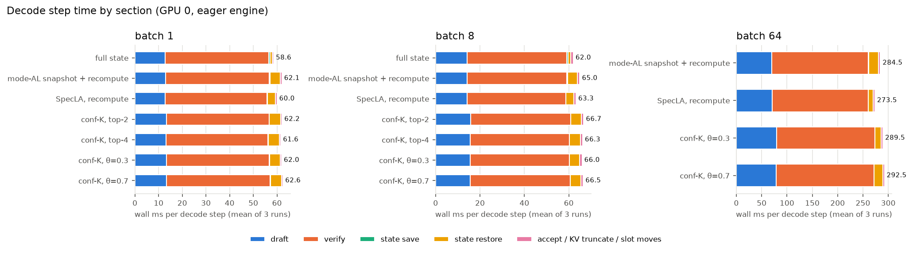
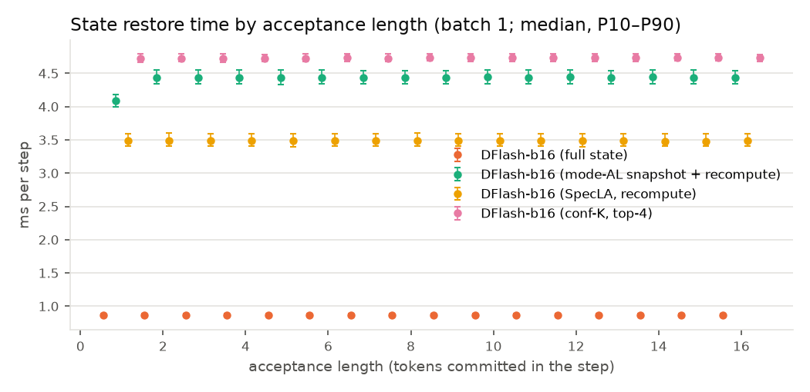
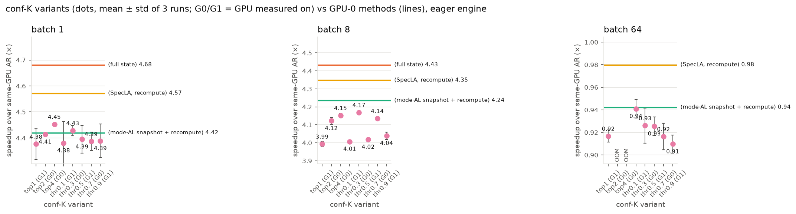

# DFlash GDN 롤백 방식 비교 — Qwen3.5-4B, RTX 3090, GSM8K-256

## 실험 조건

| 항목 | 설정 |
|---|---|
| 모델 | Target `Qwen/Qwen3.5-4B` (bf16), 드래프트 `z-lab/Qwen3.5-4B-DFlash`, block 16 (anchor 1 + draft 15) |
| 데이터 | GSM8K test 중 256문항(seed 42), zero-shot, `enable_thinking=False` |
| 생성 | `max_new_tokens=128`, `ignore_eos`, 그리디 |
| 배치 | continuous batching, batch 1 / 8 / 64 / 128, 셀당 3회 + warmup 5스텝 |
| 측정 | prefill 제외 decode 처리량. 구간마다 `synchronize()`로 시간을 잼 |
| 실행 엔진 | HF Transformers eager (CUDA graph 없음) |
| 하드웨어 | RTX 3090 두 장(GPU 0, GPU 1) |

비교한 롤백 방식(모두 검증 forward는 durable state S_0를 읽기만 함)

| 방식 | 검증 중 저장 | 수락 후 복원 |
|---|---|---|
| **fullstate** | 블록 16개 위치 전부의 recurrent + conv state | 수락 위치 저장본을 복사 |
| **SpecLA** | 없음 | S_0에서 수락 토큰(AL개)의 GDN 재귀를 재계산 |
| **modeal** | 최빈 AL 위치 m 하나(batch 공통) | 복사, 또는 m이나 S_0에서 재계산 |
| **confk** (8가지) | 드래프트 confidence로 고른 위치(시퀀스별) + 행 15 | 가장 가까운 저장본 복사 + 재계산 |

confk 위치 선택 규칙은 두 가지입니다.
- top-K(K = 1, 2, 4): P(j) = (c_1 × … × c_j)(1 − c_{j+1}) 상위 K개
- 임계값 θ(0.1 / 0.3 / 0.5 / 0.7 / 0.9): 처음부터 연속으로 c_i ≥ θ인 개수

## 1. 핵심 결과 요약

1. **정확성: 롤백 방식은 출력에 영향이 없습니다.**
   - 모든 방식에서 복원 State가 같은 입력으로 재계산한 값과 오차 0입니다.
   - 13개 DFlash 실행(4개 방식, 두 GPU)의 출력이 batch마다 **256/256 서로 완전히 같습니다.**
   - AR과의 완전 일치율은 68~74%이고, 불일치는 모두 bf16 동률 토큰입니다. 참고로 AR끼리도 batch 1과 8 사이 일치율이 72%입니다.
2. **batch 1·8에서는 fullstate가 가장 빠릅니다.** 같은 GPU 0 기준입니다.
   - batch 1: fullstate 106.2 tok/s(AR 대비 4.68배) > SpecLA 4.57배 > modeal 4.42배 ≈ confk 4.39~4.45배
   - batch 8: fullstate 4.43배 > SpecLA 4.35배 > modeal 4.24배 > confk 4.12~4.17배
3. **batch 64에서는 DFlash가 AR보다 느리고, fullstate는 실행이 불가능합니다.**
   - SpecLA 0.98배 > modeal 0.94배 > confk 0.92~0.94배이고, AR은 1225 tok/s입니다.
   - fullstate는 스냅샷만 52.7GB가 필요해 OOM입니다. confk top-2/top-4도 OOM입니다.
   - batch 128에서는 모든 DFlash가 OOM이고, AR은 1345 tok/s입니다.
4. **방식 간 차이는 거의 전부 "State 복원" 시간에서 납니다.** batch 1 스텝당 복원 시간은 fullstate 0.87ms, SpecLA 3.5ms, modeal 4.4ms, confk 약 4.7ms입니다.
   - 이 시간은 수락 길이와 무관하게 일정합니다. 재계산하는 토큰 수가 아니라 층마다 띄우는 커널 개수가 시간을 결정한다는 뜻입니다.
   - 그래서 재계산을 줄이려는 modeal·confk는 저장본 복사와 confidence 계산 비용만 더해져 SpecLA보다 느립니다.
5. **confk의 예측 정확도는 올라가도 속도는 바뀌지 않습니다.**
   - hit율(저장본 복사만으로 끝난 비율)은 top-1 44% → top-2 64% → top-4 84%로 오르고, 스텝당 재계산 토큰은 2.03 → 1.10 → 0.38로 줄었습니다.
   - 그런데 처리량은 ±1% 안에서 같습니다. 4번의 이유 때문입니다.

## 2. 결과 표

### 2.1 같은 GPU의 AR 대비 speedup (괄호는 decode tok/s, 3회 평균)

| 방식 | GPU | batch 1 | batch 8 | batch 64 | batch 128 |
|---|---|---|---|---|---|
| AR | 0 | 1.00× (22.7) | 1.00× (178.5) | 1.00× (1225) | 1.00× (1345) |
| AR | 1 | 1.00× (23.2) | 1.00× (186.5) | 1.00× (1238) | 1.00× (1354) |
| fullstate | 0 | **4.68× (106.2)** | **4.43× (791.6)** | OOM (할당) | OOM (할당) |
| SpecLA | 0 | 4.57× (103.7) | 4.35× (776.2) | **0.98× (1201)** | OOM (실행 중) |
| modeal | 0 | 4.42× (100.2) | 4.24× (756.1) | 0.94× (1154) | OOM (할당) |
| confk top-2 | 0 | 4.41× (100.1) | 4.12× (735.9) | OOM (warmup) | OOM (할당) |
| confk top-4 | 0 | 4.45× (101.0) | 4.15× (741.2) | OOM (할당) | OOM (할당) |
| confk θ=0.3 | 0 | 4.43× (100.4) | 4.17× (744.2) | 0.93× (1135) | OOM (할당) |
| confk θ=0.7 | 0 | 4.39× (99.5) | 4.14× (738.3) | 0.92× (1123) | OOM (할당) |
| SpecLA | 1 | 4.49× (103.9) | 4.15× (773.3) | 0.98× (1219) | OOM (실행 중) |
| modeal | 1 | 4.44× (102.7) | 4.14× (771.9) | 0.95× (1172) | OOM (할당) |
| confk top-1 | 1 | 4.38× (101.3) | 3.99× (744.5) | 0.92× (1135) | OOM (할당) |
| confk θ=0.1 | 1 | 4.38× (101.4) | 4.01× (747.1) | 0.94× (1165) | OOM (할당) |
| confk θ=0.5 | 1 | 4.39× (101.7) | 4.02× (749.3) | 0.93× (1145) | OOM (할당) |
| confk θ=0.9 | 1 | 4.39× (101.6) | 4.04× (753.1) | 0.91× (1126) | OOM (할당) |

- 3회 반복의 표준편차는 대부분 평균의 1% 미만입니다(예외: AR batch 128 ±4.7%, modeal GPU 0 batch 8 ±1%).
- τ는 모든 DFlash 셀에서 6.22(batch 1) / 6.26(batch 8) / 6.23(batch 64)로 같습니다. 출력이 같기 때문입니다.

### 2.2 구간별 시간과 메모리 (GPU 0, run당 합계 초, 256문항)

| 방식 | batch | draft | verify | 저장 | 복원 | 기타 | 롤백 비중¹ | peak GB | snapshot GB |
|---|---|---|---|---|---|---|---|---|---|
| fullstate | 1 | 66.6 | 228.9 | 2.84 | **4.53** | 3.35 | **2.4%** | 10.8 | 0.82 |
| SpecLA | 1 | 66.7 | 225.2 | 0.05 | 18.25 | 3.33 | 5.8% | 10.0 | 0 |
| modeal | 1 | 67.3 | 228.6 | 2.11 | 23.01 | 3.39 | 7.7% | 10.1 | 0.05 |
| confk top-4 | 1 | 68.6 | 225.2 | 0.05 | 24.70 | 3.34 | 7.7% | 10.3 | 0.25 |
| fullstate | 8 | 9.4 | 29.7 | 0.37 | 0.91 | 0.71 | 3.1% | 17.3 | 6.59 |
| SpecLA | 8 | 9.4 | 29.5 | 0.01 | 2.33 | 0.70 | 5.6% | 10.7 | 0 |
| modeal | 8 | 9.4 | 29.7 | 0.27 | 2.96 | 0.71 | 7.5% | 11.1 | 0.41 |
| confk top-4 | 8 | 10.3 | 29.6 | 0.01 | 3.19 | 0.70 | 7.7% | 12.8 | 2.01 |
| SpecLA | 64 | 7.0 | 18.7 | 0.00 | 0.97 | 0.34 | 3.6% | 17.1 | 0 |
| modeal | 64 | 7.0 | 18.8 | 0.07 | 1.95 | 0.35 | 7.2% | 20.4 | 3.30 |
| confk θ=0.3 | 64 | 7.9 | 19.2 | 0.00 | 1.18 | 0.34 | 4.1% | 23.6 | 6.44 |

¹ (저장 + 복원) / decode 시간, 동기화 구간으로 실측한 값입니다. fullstate의 recurrent 스냅샷 쓰기는 검증 커널 안에 융합되어 있어 "verify"에 포함됩니다(아래 3.2 참조).

전체 표는 `table_all.md`와 `summary_all.csv`에 있습니다(TPOT, 표준편차, 보정 측정, 출력 일치율 포함). 그래프는 `plots/`에 있습니다.

## 3. 분석

### 3.1 batch가 커질수록 speedup이 사라지는 이유

- **batch 1·8**: 스텝 시간의 약 75%가 검증 forward(16토큰)입니다. 하지만 HF eager 실행이라 이 시간 대부분이 커널 런칭 CPU 오버헤드이고, 토큰 수와 거의 무관합니다. 그래서 한 스텝에 6.2토큰을 확정하는 DFlash가 AR(스텝당 1토큰, TPOT 44ms)보다 4.4~4.7배 빠릅니다.
- **batch 64**: 검증 한 번이 64 × 16 = 1,024토큰을 처리해 3090의 연산량 한계에 걸립니다. DFlash 스텝은 약 280ms(TPOT 50ms)로, 같은 batch의 AR TPOT(52ms)과 비슷해집니다. 스텝당 확정 토큰이 많아도 스텝 자체가 그만큼 느려져 이득이 없고, 드래프트 비용(스텝의 약 25%)이 그대로 손해로 남습니다.
- **batch 128**: DFlash는 모든 방식이 메모리 부족입니다. durable GDN state(6.4GB), KV, 드래프트 컨텍스트 feature, 검증 activation에 롤백 버퍼까지 더해지기 때문입니다.

### 3.2 롤백 오버헤드

- **복원 시간은 AL과 무관하게 일정합니다**(batch 1 중앙값: fullstate 0.86ms, SpecLA 3.5ms, modeal 4.4ms).
  - SpecLA의 재계산 커널은 수락 토큰 수만큼 반복하지만, 24층 × (재계산 커널 + conv 창 gather + 복사) 커널 런칭 시간이 지배합니다.
  - fullstate는 층마다 복사 두 번만 하면 됩니다.
- **fullstate의 스냅샷 쓰기 비용은 지금 환경에서는 가려져 있습니다.**
  - 보정 측정(저장 있음/없음 커널 비교)에서 batch 8의 recurrent 스냅샷 쓰기는 스텝당 **GPU 7.6ms**입니다(16위치 × 8시퀀스 × 24층 = 6.4GB 쓰기).
  - 그런데 verify 실측 시간은 SpecLA와 같습니다(29.7s 대 29.5s). CPU가 커널을 띄우는 동안 GPU가 놀고 있어서, 그 사이에 쓰기가 끝나기 때문입니다.
  - **CUDA graph 등으로 CPU 오버헤드를 없앤 서빙 엔진에서는 이 비용이 그대로 드러나고**, batch가 클수록 fullstate가 불리해집니다. 이 결과의 가장 중요한 한계입니다.
- 롤백 비중(저장 + 복원 실측)은 batch 1·8 기준 fullstate 2~3%, SpecLA 6%, modeal·confk 7~8%입니다. 이 차이가 처리량 차이(batch 1 기준 fullstate가 SpecLA보다 2.4%, modeal보다 6% 빠름)와 거의 같은 크기입니다.

### 3.3 confk: 예측 품질과 속도

| 변형 | slot/시퀀스 | hit율 (복사만) | S_0에서 재계산 | 스텝당 재계산 토큰 | 메모리 한계 |
|---|---|---|---|---|---|
| top-1 | 2 | 44.0% | 13.8% | 2.03 | batch 64까지 |
| top-2 | 3 | 64.3% | 5.8% | 1.10 | batch 8까지 |
| top-4 | 5 | 84.0% | 2.0% | 0.38 | batch 8까지 |
| θ=0.1 | 2 | 8.2% | 91.6% | 4.98 | batch 64까지 |
| θ=0.3 | 2 | 20.0% | 75.0% | 4.07 | batch 64까지 |
| θ=0.5 | 2 | 35.8% | 42.6% | 2.72 | batch 64까지 |
| θ=0.7 | 2 | 42.7% | 15.4% | 2.05 | batch 64까지 |
| θ=0.9 | 2 | 36.1% | 4.0% | 2.46 | batch 64까지 |

(batch 1 기준이며, batch 8·64도 ±1%p 안에서 같습니다. 행 15(전부 수락) 저장분이 hit의 일부를 차지합니다.)

- **θ가 낮으면** 거의 모든 위치가 θ를 넘어 저장 위치가 너무 뒤로 잡힙니다. 실제 AL이 그보다 짧아 S_0에서 재계산하게 됩니다(θ=0.1: 92%). **θ가 높으면** 저장 위치가 앞쪽이 되어 저장본에서 재계산합니다(θ=0.9: S_0 4%). 중간인 θ=0.7이 hit율로는 top-1과 비슷합니다.
- **top-K는 K가 클수록 hit율이 오르지만**, slot이 늘어 batch 64부터 메모리에 들어가지 않습니다.
- **그래도 처리량은 변형 사이에 거의 같습니다**(같은 GPU 안에서 batch 1 99.5~101.0, batch 8 736~744 tok/s). 이유는 3.2와 같습니다. 복원 시간이 재계산 토큰 수가 아니라 커널 개수로 정해지기 때문입니다.
- confidence 계산(드래프트 logits 248K 어휘 softmax)은 스텝당 약 0.5ms를 draft에 더합니다(draft 66.6s → 68.6~69.7s).
- 결과적으로 confk는 같은 GPU의 SpecLA보다 batch 1에서 약 3%, batch 8에서 4~5% 느립니다.

### 3.4 modeal

- 수락 길이 분포의 최빈값이 2(스텝의 14%)이고 꼬리가 깁니다. 분포는 1: 11%, 2: 14%, 3: 11%, …, 16: 7%입니다.
- 그래서 m은 거의 항상 2이고, 저장본을 그대로 쓰는 경우가 약 14%뿐입니다. 나머지는 m 또는 S_0에서 재계산합니다.
- 결과적으로 저장 비용(conv 창 복사)과 복사 비용만 더해져 SpecLA보다 느립니다(같은 GPU에서 batch 1 −3.4%, batch 8 −2.6%, batch 64 −3.8%).

### 3.5 GPU 간 차이 (보정)

같은 방식을 두 GPU에서 잰 결과, GPU 1이 0~4% 빠릅니다(AR batch 8 +4.4%, modeal +2%, SpecLA −0.4~+1.5%).

이 정도면 GPU가 다른 셀끼리 처리량을 직접 비교할 수 없습니다. 그래서 본문 비교는 같은 GPU(GPU 0)에서 잰 fullstate·SpecLA·modeal·confk 4가지를 기준으로 했고, 2.1의 speedup도 같은 GPU의 AR로 계산했습니다. 다만 GPU 차이가 방식마다 다르게 나타나므로(AR이 더 큰 폭으로 빨라짐), GPU 1 셀의 speedup은 GPU 0 셀보다 약간 낮게 나옵니다.

## 4. 결정 기록 (명세 외 결정)

| # | 결정 | 이유 |
|---|---|---|
| 1 | DFlash `pip install -e --no-deps` (커밋 07ebd93) | `dflash[local]`이 torch·transformers 버전을 바꾸기 때문 |
| 2 | 블록 = anchor + draft 15 (공식 정의와 같음), bonus는 다음 블록 anchor | 공식 루프 |
| 3 | 위치별 State는 fused Triton 커널로 한 번에 저장 | 토큰 루프 대비 batch 1에서 35배, batch 8에서 8배 저렴(실측) |
| 4 | KV truncate = 확정 길이 갱신 (뒤쪽은 마스크 후 덮어씀) | 정적 버퍼 설계 |
| 5 | decode 처리량은 decode가 만든 127토큰/시퀀스만 셈 | 첫 토큰은 prefill이 생성 (보수적) |
| 6 | warmup "5 iteration" = batch를 채운 decode 5스텝 | |
| 7 | GDN 스냅샷 쓰기 비용은 커널 저장 on/off 보정 측정으로 따로 보고 | 융합 커널이라 실행 중 분리 불가 |
| 8 | **Phase 3 출력 검증 39/50(불일치는 모두 bf16 동률)을 사용자 승인으로 통과** (`--accept-tie-mismatch`) | 원인은 batch 비불변 커널(M=1 GEMV, RMSNorm reduction 순서)이고 롤백은 비트 단위로 정확 |
| 9 | 마지막 블록도 16 유지 (확정 수만 자름) | batch에서 시퀀스마다 남은 길이가 다름 |
| 10 | SpecLA 측정은 GPU 1에서 동시에 진행 (사용자 승인) | 시간 단축 |
| 11 | **GPU 1용 AR을 따로 측정**하고, speedup은 같은 GPU의 AR로 계산 | 두 GPU의 env.json이 `gpu_total_gb`에서 다름(물리 GPU가 다름) |
| 12 | modeal·SpecLA를 GPU 0에서 한 번 더 측정 (Phase 3 생략: 같은 코드) | 같은 GPU에서 4가지 방식 직접 비교 |
| 13 | `results_modeal/env.json`을 GPU 1 값으로 교체 (원본은 `env_phase0_gpu0.json`에 보존), fullstate 셀에 GPU 정보 보충 기록 | Phase 0과 Phase 4가 서로 다른 GPU에서 실행됨, 필드 추가 전 실행 |
| 14 | modeal: run마다 히스토그램 초기화, 첫 m = 8, 동률이면 작은 AL | 명세 없음 |
| 15 | confk: confidence = 드래프트 softmax의 선택 토큰 확률. 행 15를 항상 저장하고, θ 규칙에서 행 15와 겹치면 slot 하나만 사용. 복원은 modeal 방식(k, v, g, β 재사용 재계산) | 사용자 지정 |

## 5. 실패·OOM·이상치

- **OOM**:
  - fullstate batch 64·128(할당 단계)
  - modeal batch 128(할당)
  - confk top-2 batch 64(warmup), 128(할당)
  - confk top-4 batch 64·128(할당)
  - confk top-1·θ 계열 batch 128(할당)
  - **SpecLA batch 128은 할당은 됐으나 run1 실행 중 OOM**입니다. 492MB 요청 시점에 예약됐지만 쓰이지 않은 메모리가 1.23GB 있어 단편화로 보입니다. 두 GPU에서 똑같이 재현됐습니다. `expandable_segments` 설정이면 들어갈 수 있으나 조건 일관성을 위해 적용하지 않았습니다.
- **수정된 버그**:
  - 드래프트 블록 입력이 mask 토큰이 아니라 버퍼 잔여값이던 문제(τ 1.17 → 6.2). 수정 전 Phase 3 결과는 `results_fullstate/superseded/`에 보존했습니다.
- **이상치·측정 주의**:
  - AR batch 128 run1이 1272 tok/s로 run2·3(1381)보다 낮습니다.
  - modeal batch 1의 GDN 저장 보정값이 음수(−1.4ms)입니다. 위치 1개 저장 비용이 측정 잡음보다 작다는 뜻입니다.
  - `cuInit` 간헐 실패는 재시도 래퍼로 처리했고, 결과에는 영향이 없습니다.

## 6. 한계와 제안

- 이 순위(fullstate > SpecLA > modeal ≈ confk)는 **CPU 런칭 오버헤드가 지배하는 HF eager 환경의 결과**입니다. CUDA graph를 쓰는 엔진에서는 다음이 달라질 수 있습니다.
  - fullstate의 스냅샷 쓰기(batch 8에서 스텝당 GPU 7.6ms)가 드러납니다.
  - 재계산 커널 비용이 실제 토큰 수에 비례하게 됩니다.
  - 그러면 SpecLA나 confk(높은 hit율)가 유리해질 수 있습니다.
- 다음 단계로는 decode 스텝을 CUDA graph로 캡처한 엔진에서 같은 매트릭스를 다시 재는 것을 권합니다. 이 리포트의 보정 측정(GDN 저장 GPU 시간)과 복원 커널 수 분석이 그 결과를 예측하는 기준이 됩니다.
- 데이터는 GSM8K, 128토큰, thinking 꺼짐 조건 하나뿐입니다. AL 분포가 다른 과제(코드, 긴 출력)에서는 modeal·confk의 hit율이 달라집니다.
