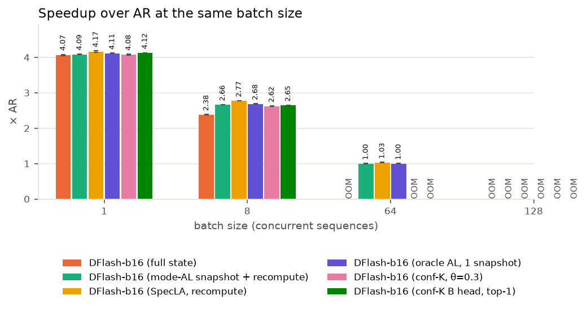

# CUDA graph 엔진 결과 — DFlash GDN 롤백 방식 비교 (Qwen3.5-4B, RTX 3090, GSM8K-256)

eager 엔진에서 했던 롤백 실험 전체를 CUDA graph 엔진으로 다시 측정한 결과입니다. eager 결과, DDTree까지 포함한 전체 정리는 `results_compare/report.md`에 있습니다.

## 실험 조건

| 항목 | 설정 |
|---|---|
| 모델 | Target `Qwen/Qwen3.5-4B` (bf16), 드래프트 `z-lab/Qwen3.5-4B-DFlash`, block 16 (anchor 1 + draft 15) |
| 데이터 | GSM8K test 중 256문항(seed 42), zero-shot, `enable_thinking=False` |
| 생성 | `max_new_tokens=128`, `ignore_eos`, 그리디 |
| 배치 | continuous batching, batch 1 / 8 / 64 / 128, 셀당 3회 + warmup 5스텝 |
| 측정 | prefill을 뺀 decode 처리량. 구간 시간은 graph 안에 넣은 CUDA 이벤트로 잰 GPU 시간, 스텝 전체는 실제 경과 시간 |
| 엔진 | decode 한 스텝을 CUDA graph로 녹화해 재생 (아래 설명) |
| 하드웨어 | RTX 3090 GPU 0 한 장 (모든 셀) |

**CUDA graph 엔진이 eager와 다른 점**
- 한 스텝(초안 → 검증 → 저장 → 수락 → 복원 → 길이 갱신)을 통째로 녹화해 재생합니다. CPU가 커널을 하나씩 띄우는 시간이 없어집니다.
- batch 크기별로 graph를 따로 녹화합니다(1, 2, 4, …, batch). 살아 있는 시퀀스 수 이상인 것 중 가장 작은 graph를 씁니다.
- 모양이 고정돼야 해서 attention은 항상 버퍼 전체 길이로 계산합니다(마스크로 가림).
- 드래프트 컨텍스트는 항상 최근 16개 위치를 씁니다. 프롬프트의 드래프트 컨텍스트는 시퀀스를 넣을 때 미리 기록하고, 이 시간은 draft 시간에 넣었습니다.
- 롤백 커널과 계산은 eager와 같습니다. 고정 모양이 필요한 부분(modeal, conf-K)만 graph용으로 다시 짰습니다.

**비교한 방식 (19가지)**

| 방식 | 검증 중에 저장하는 것 | 수락 뒤 복원 |
|---|---|---|
| fullstate | 블록 16개 위치 전부의 State | 수락 위치의 저장본을 복사 |
| SpecLA | 없음 (검증에서 나온 k, v, g, β를 들고 있음) | S_0에서 수락 토큰만큼 다시 계산 |
| modeal | 가장 자주 나온 AL 위치 m 하나 | 복사, 또는 m이나 S_0에서 다시 계산 |
| conf-K A (8가지) | 드래프트 softmax 확률로 고른 위치 + 마지막 위치 | 가장 가까운 저장본에서 다시 계산 |
| conf-K B (8가지) | 학습한 head의 확률로 고른 위치 + 마지막 위치 | A와 같음 |

conf-K 변형은 top-K(K = 1, 2, 4)와 θ(0.1 / 0.3 / 0.5 / 0.7 / 0.9) 8가지입니다. 방법 B는 동료가 준 `confk-head-B`의 mlp head로, confidence 자리만 sigmoid(MLP([드래프트 hidden ; 앞 토큰 임베딩]))로 바꿉니다.

## 1. 핵심 요약

1. **정확성:** oracle까지 20가지 방식 모두 복원 State가 같은 입력으로 다시 계산한 값과 오차 0입니다. 60번의 DFlash 실행(oracle 포함) 출력이 batch마다 256문항 모두 서로 같습니다.
2. **가장 빠른 방식은 SpecLA입니다.** eager에서는 fullstate가 1등이었는데 순위가 바뀌었습니다.
   - batch 1: SpecLA **269.1 tok/s (AR의 4.17배)** > conf-K B top-1 266.2 > modeal 263.9 > fullstate 262.7
   - batch 8: SpecLA **1047.4 tok/s (2.77배)** > modeal 1005 ≈ conf-K B 985~1003 > conf-K A 967~991 > fullstate **900.1 (2.38배)**
   - batch 64: SpecLA 1.03배, modeal 1.00배. 나머지는 메모리 부족(OOM)
   - batch 128: 모든 DFlash가 OOM. AR은 1209 tok/s
3. **fullstate가 밀린 이유는 State 쓰기 비용입니다.** batch 8에서 fullstate의 검증 시간이 SpecLA보다 스텝당 7.6ms 깁니다. eager에서 따로 보정 측정해 둔 값(7.6ms)과 같습니다. eager에서는 CPU 대기 시간에 가려져 있었습니다.
4. **복원 시간이 이제 수락 길이에 비례합니다.** SpecLA는 AL 1에서 0.40ms, AL 16에서 0.66ms로 토큰당 약 17µs씩 늘어납니다. 다시 계산하는 비용 자체가 작아서, 저장본으로 이를 아끼려는 modeal·conf-K는 저장·복사 비용을 메우지 못합니다.
5. **수락 길이를 완벽하게 알아도(oracle, 적중 100%) SpecLA보다 1~3% 느립니다.** 14%만 맞히는 modeal과 1% 안쪽 차이입니다. 예측이 아니라 저장본을 두는 비용이 문제입니다(3.6절).
6. **conf-K B는 A보다 예측은 덜 맞지만 1~2% 빠릅니다.** 큰 어휘 softmax가 빠져 draft가 스텝당 1.1ms 짧아지기 때문입니다. A·B 모두 SpecLA보다는 4~7% 느립니다.
7. **eager보다 2.5~2.9배 빠르지만 speedup은 줄었습니다.** batch 1에서 SpecLA 103.7 → 269.1 tok/s이지만, AR도 22.7 → 64.6 tok/s로 빨라져 AR 대비 배수는 4.57배 → 4.17배가 됐습니다.

## 2. 결과 표

### 2.1 AR 대비 speedup (괄호는 decode tok/s, 3회 평균)

| 방식 | batch 1 | batch 8 | batch 64 | batch 128 |
|---|---|---|---|---|
| AR | 1.00× (64.6) | 1.00× (377.6) | 1.00× (1122) | 1.00× (1209) |
| fullstate | 4.07× (262.7) | 2.38× (900.1) | OOM | OOM |
| modeal | 4.09× (263.9) | 2.66× (1005.3) | 1.00× (1122) | OOM |
| **SpecLA** | **4.17× (269.1)** | **2.77× (1047.4)** | **1.03× (1159)** | OOM |
| conf-K A top-1 | 4.08× (263.7) | 2.60× (981.9) | OOM | OOM |
| conf-K A top-2 | 4.06× (262.2) | 2.59× (977.5) | OOM | OOM |
| conf-K A top-4 | 4.05× (261.4) | 2.56× (967.3) | OOM | OOM |
| conf-K A θ=0.1 | 4.07× (262.8) | 2.62× (990.9) | OOM | OOM |
| conf-K A θ=0.3 | 4.08× (263.4) | 2.62× (988.4) | OOM | OOM |
| conf-K A θ=0.5 | 4.08× (263.3) | 2.61× (986.8) | OOM | OOM |
| conf-K A θ=0.7 | 4.07× (263.0) | 2.60× (982.7) | OOM | OOM |
| conf-K A θ=0.9 | 4.07× (262.8) | 2.59× (978.0) | OOM | OOM |
| conf-K B top-1 | **4.12× (266.2)** | 2.65× (999.1) | OOM | OOM |
| conf-K B top-2 | 4.07× (263.1) | 2.63× (994.0) | OOM | OOM |
| conf-K B top-4 | 4.06× (262.5) | 2.61× (985.4) | OOM | OOM |
| conf-K B θ=0.1 | 4.08× (263.8) | 2.65× (1002.0) | OOM | OOM |
| conf-K B θ=0.3 | 4.09× (264.0) | 2.66× (1003.4) | OOM | OOM |
| conf-K B θ=0.5 | 4.08× (263.8) | 2.65× (1000.0) | OOM | OOM |
| conf-K B θ=0.7 | 4.09× (264.0) | 2.65× (999.0) | OOM | OOM |
| conf-K B θ=0.9 | 4.09× (264.1) | 2.63× (993.0) | OOM | OOM |
| oracle (정답 위치 1칸, 적중 100%) | 4.11× (265.6) | 2.68× (1012.7) | 1.00× (1122) | OOM |

- 3회 반복의 표준편차는 모두 평균의 1% 미만입니다(가장 큰 것: conf-K B top-1 batch 1, 0.8%).
- τ(스텝당 확정 토큰)는 모든 DFlash 셀에서 6.20(batch 1) / 6.22(batch 8) / 6.23(batch 64)입니다. 출력이 같기 때문입니다.
- 전체 표(TPOT, 표준편차, 구간 시간 합계, 메모리, AR 대비 출력 일치율)는 `table_all.md`, `summary_all.csv`에 있습니다.

### 2.2 스텝당 구간 시간 (ms, 3회 평균)

| 방식 | batch | draft | verify | 저장 | 복원 | 스텝 전체 |
|---|---|---|---|---|---|---|
| AR | 1 | – | 15.45 | – | – | 15.48 |
| fullstate | 1 | 5.21 | 18.00 | 0.10 | **0.23** | 23.61 |
| modeal | 1 | 5.19 | 17.49 | 0.19 | 0.56 | 23.51 |
| SpecLA | 1 | 5.20 | **17.29** | 0.00 | 0.49 | **23.05** |
| conf-K A top-1 | 1 | 5.44 | 17.47 | 0.00 | 0.54 | 23.52 |
| conf-K B top-1 | 1 | 5.28 | 17.41 | 0.00 | 0.54 | 23.30 |
| AR | 8 | – | 21.15 | – | – | 21.19 |
| fullstate | 8 | 12.18 | **39.70** | 0.43 | 1.25 | 54.07 |
| modeal | 8 | 12.27 | 33.02 | 0.23 | 2.35 | 48.41 |
| SpecLA | 8 | 12.18 | **32.12** | 0.00 | 1.65 | **46.47** |
| conf-K A top-1 | 8 | 13.58 | 33.46 | 0.00 | 1.99 | 49.57 |
| conf-K B top-1 | 8 | 12.50 | 33.73 | 0.00 | 1.97 | 48.71 |
| AR | 64 | – | 56.97 | – | – | 57.04 |
| modeal | 64 | 79.08 | 204.36 | 0.80 | 14.44 | 301.80 |
| SpecLA | 64 | 78.98 | 200.49 | 0.00 | 9.79 | 292.30 |

- fullstate·modeal·conf-K의 위치별 State 쓰기는 검증 커널 안에서 일어나서 "verify"에 들어 있습니다. "저장" 열은 conv 창 복사 등 따로 하는 작업만입니다.
- conf-K의 draft에는 confidence 계산(A: 어휘 전체 softmax, B: head)이 들어 있습니다.

### 2.3 메모리 (peak는 측정 중 최대 할당량, 저장본은 롤백용 State 버퍼)

| 방식 | batch 1 peak / 저장본 | batch 8 peak / 저장본 | batch 64 | batch 128 |
|---|---|---|---|---|
| AR | 10.0 GB / – | 10.5 GB / – | 15.1 GB | 20.4 GB |
| fullstate | 11.0 / 0.82 GB | 17.4 / 6.59 GB | OOM (저장본만 52.7 GB 필요) | OOM (105 GB 필요) |
| modeal | 10.1 / 0.05 GB | 11.1 / 0.41 GB | 20.2 / 3.30 GB | OOM |
| SpecLA | 10.0 / 0 | 10.7 / 0 | 16.9 GB | OOM (graph 녹화 중) |
| conf-K A·B 2칸 (top-1, θ 계열) | 10.1 / 0.10 GB | 11.5 / 0.81 GB | OOM | OOM |
| conf-K A·B top-2 (3칸) | 10.2 / 0.15 GB | 11.9 / 1.21 GB | OOM | OOM |
| conf-K A·B top-4 (5칸) | 10.3 / 0.25 GB | 12.8 / 2.01 GB | OOM | OOM |

- 녹화한 graph들이 쓰는 메모리가 약 3.2 GB 더 있습니다. 그래서 eager에서는 batch 64가 돌던 conf-K 2칸 변형도 graph에서는 OOM이 났습니다.

### 2.4 conf-K 예측 통계 (batch 1, batch 8도 ±1%p 안에서 같음)

| 변형 | 저장 칸/시퀀스 | A 저장본만으로 끝남 | B 저장본만으로 끝남 | A 처음(S_0)부터 재계산 | B 처음부터 재계산 | A 행당 재계산 토큰 | B 행당 재계산 토큰 |
|---|---|---|---|---|---|---|---|
| top-1 | 2 | 44.3% | 30.4% | 13.9% | 31.1% | 2.04 | 2.56 |
| top-2 | 3 | 64.3% | 49.8% | 5.9% | 16.2% | 1.12 | 1.53 |
| top-4 | 5 | 83.8% | 72.6% | 2.0% | 6.2% | 0.39 | 0.65 |
| θ=0.1 | 2 | 8.1% | 8.2% | 91.6% | 91.5% | 4.98 | 4.97 |
| θ=0.3 | 2 | 20.1% | 15.7% | 75.0% | 78.7% | 4.05 | 4.18 |
| θ=0.5 | 2 | 36.1% | 25.0% | 42.8% | 57.9% | 2.73 | 3.24 |
| θ=0.7 | 2 | 42.9% | 30.2% | 15.3% | 34.4% | 2.04 | 2.60 |
| θ=0.9 | 2 | 36.2% | 29.6% | 3.9% | 9.4% | 2.47 | 2.69 |

- 방법 A의 값은 eager 결과(top-1 44.0%, top-4 84.0% 등)와 같습니다.
- 전체 표는 `rollback_stats.md`에 있습니다.

### 2.5 eager 대비 (같은 GPU 0)

| 방식 | batch | eager tok/s | graph tok/s | graph/eager | eager speedup | graph speedup |
|---|---|---|---|---|---|---|
| AR | 1 | 22.7 | 64.6 | 2.85 | 1.00 | 1.00 |
| AR | 8 | 178.5 | 377.6 | 2.12 | 1.00 | 1.00 |
| AR | 64 | 1225 | 1122 | 0.92 | 1.00 | 1.00 |
| AR | 128 | 1345 | 1209 | 0.90 | 1.00 | 1.00 |
| fullstate | 1 | 106.2 | 262.7 | 2.47 | 4.68 | 4.07 |
| fullstate | 8 | 791.6 | 900.1 | 1.14 | 4.43 | 2.38 |
| modeal | 1 | 100.2 | 263.9 | 2.63 | 4.42 | 4.09 |
| modeal | 8 | 756.1 | 1005.3 | 1.33 | 4.24 | 2.66 |
| modeal | 64 | 1154 | 1122 | 0.97 | 0.94 | 1.00 |
| SpecLA | 1 | 103.7 | 269.1 | 2.60 | 4.57 | 4.17 |
| SpecLA | 8 | 776.2 | 1047.4 | 1.35 | 4.35 | 2.77 |
| SpecLA | 64 | 1201 | 1159 | 0.97 | 0.98 | 1.03 |
| conf-K A top-4 | 1 | 101.0 | 261.4 | 2.59 | 4.45 | 4.05 |
| conf-K A top-4 | 8 | 741.3 | 967.3 | 1.31 | 4.15 | 2.56 |
| conf-K A θ=0.3 | 1 | 100.4 | 263.4 | 2.62 | 4.43 | 4.08 |
| conf-K A θ=0.3 | 8 | 744.2 | 988.4 | 1.33 | 4.17 | 2.62 |
| conf-K A θ=0.3 | 64 | 1135 | OOM | – | 0.93 | – |

eager의 conf-K 중 GPU 0에서 잰 변형만 넣었습니다. 전체는 `eager_vs_graph.md`에 있습니다.

## 3. 분석

### 3.1 fullstate: 숨어 있던 State 쓰기 비용이 드러남

- fullstate는 검증 중에 16개 위치의 State를 모두 씁니다. batch 8이면 스텝당 6.4 GB를 씁니다(16위치 × 8시퀀스 × 24층 × 2.1 MB).
- eager에서는 보정 측정으로만 이 비용(스텝당 GPU 7.6ms)을 볼 수 있었습니다. CPU가 커널을 띄우는 동안 GPU가 놀고 있어서 실제 시간에는 드러나지 않았습니다.
- graph 엔진에서는 그 대기 시간이 없어서 비용이 그대로 보입니다. batch 8 verify가 39.7ms로 SpecLA(32.1ms)보다 7.6ms 깁니다. 복원에서 아끼는 0.4ms보다 훨씬 커서 SpecLA보다 14% 느립니다.
- batch 1에서는 쓰기량이 1/8이라 차이가 작습니다(verify +0.7ms, 복원 −0.26ms, 스텝 +0.56ms, 2.4% 느림).
- 아래 그림은 방식마다 구간별로 SpecLA보다 얼마나 느린지(+)·빠른지(−)입니다. SpecLA가 앞서는 구간은 사실상 verify(저장 쓰기) 하나지만, 그 차이가 다른 구간의 이득보다 커서 스텝 전체로는 모든 방식이 SpecLA보다 느립니다.

### 3.2 복원 시간이 수락 길이에 비례함

- eager에서는 복원 시간이 AL과 상관없이 평평했습니다(커널 띄우는 시간이 지배).
- graph에서는 SpecLA 복원이 AL 1에서 0.40ms, AL 16에서 0.66ms로 토큰당 약 17µs씩 늘어납니다. modeal은 같은 기울기에 약 0.05ms가 더 붙고, fullstate는 0.23ms로 일정합니다.
- 다시 계산하는 비용이 batch 1 스텝(23ms)의 약 2%뿐이라, 이것을 줄여서 얻을 수 있는 이득이 처음부터 작습니다.

### 3.3 batch가 커지면

- batch 8: 검증이 128토큰(8 × 16)을 처리하면서 실제 연산량이 늘어 speedup이 2.4~2.8배로 내려갑니다.
- batch 64: 검증 한 번이 1,024토큰을 처리합니다. SpecLA 스텝 292ms가 AR 스텝(57ms)의 5.1배이고, 스텝당 확정 토큰(τ 6.23)과 거의 같아 이득이 사라집니다(1.03배).
- AR은 batch 64·128에서 eager보다 8~10% 느립니다. graph 엔진이 attention을 항상 버퍼 전체 길이로 계산하기 때문입니다.

### 3.4 저장 위치를 하나만 둔다면 (modeal 분석)

- 가장 자주 나오는 AL은 2지만 전체의 13.6~13.8%뿐입니다. modeal의 m은 스텝의 93~97%에서 2였습니다.
- m = 2이면 저장본 복사만으로 끝나는 경우는 13.8%이고, 75.7%는 저장본에서 다시 계산, 10.5%는 S_0부터 다시 계산합니다.
- 측정한 AL로 위치별 기대 재계산량을 계산하면 다음과 같습니다.

| 저장 위치 s | 행당 재계산 토큰 | batch 8 스텝 안 최장 재계산 | batch 1 예상 복원 ms |
|---|---|---|---|
| 없음 (SpecLA) | 6.20 | 13.3 | 0.486 (실측) |
| 2 (지금 modeal) | 4.43 | 11.3 | 0.559 (실측) |
| 6 | **3.47 (최소)** | 7.80 | 0.515 |
| 8 | 3.64 | **6.93 (최소)** | **0.509** |
| 9 | 3.79 | 6.95 | **0.509** |

- 위치 하나를 둔다면 블록 가운데(s = 8)가 가장 무난합니다. 그래도 저장 비용(저장 구간 약 0.19ms + verify 약 0.2ms)이 아끼는 계산(최대 약 0.11ms)보다 커서, graph 엔진에서는 어느 위치도 SpecLA를 이기지 못합니다.

### 3.5 conf-K: 방법 A와 B

- 예측은 A가 더 잘 맞습니다. top-K에서 저장본만으로 끝나는 비율이 B보다 11~14%p 높습니다. 패키지 README의 오프라인 결과와 같은 방향입니다.
- 속도는 B가 8가지 변형 모두에서 조금 빠릅니다(batch 8에서 1~2%). B는 어휘 24만 개 softmax를 하지 않아 draft가 1.1ms 짧고(head 자체는 0.3ms), 더 늘어난 재계산은 복원 시간에 거의 영향이 없습니다.
- A·B 모두 SpecLA보다 느립니다. 저장 칸을 검증 중에 쓰는 비용(verify +1.3~2.4ms)과 confidence 계산 비용이 아끼는 재계산보다 큽니다.
- 같은 이유로 A 안에서도 예측이 잘 맞는 top-4(84%)가 가장 느립니다. 저장 칸이 5개라 쓰기 비용이 가장 큽니다.

### 3.6 oracle: 수락 길이를 완벽하게 안다면

- SpecLA 실행 기록(같은 엔진·같은 batch에서는 방식과 무관하게 수락 길이가 같음)을 정답으로 써서, 시퀀스마다 실제로 확정될 위치의 State 한 칸만 저장하고 복원은 복사했습니다. 정답 전송 시간은 측정에서 뺐습니다(예측이 공짜이고 완벽할 때의 상한).

| batch | 방식 | 저장본 적중 | tok/s | verify ms | 복원 ms | 스텝 ms |
|---|---|---|---|---|---|---|
| 1 | SpecLA | – | **269.1** | 17.29 | 0.49 | **23.05** |
| 1 | oracle | 100% | 265.6 | 17.53 | 0.50 | 23.36 |
| 8 | SpecLA | – | **1047.4** | 32.12 | 1.65 | **46.47** |
| 8 | oracle | 100% | 1012.7 | 33.45 | 1.60 | 48.06 |
| 8 | modeal | 14% | 1005.3 | 33.02 | 2.35 | 48.41 |
| 64 | SpecLA | – | **1158.6** | 200.49 | 9.79 | **292.30** |
| 64 | oracle | 100% | 1122.0 | 208.71 | 9.54 | 301.85 |

- fullstate보다는 빠르지만(batch 8 +12.5%) SpecLA보다 느립니다(−1.3~−3.3%).
- 복원 시간은 SpecLA와 거의 같습니다. 복원의 대부분은 State(층마다 시퀀스당 2 MiB)를 읽고 쓰는 시간이고, 이 양은 저장본 복사나 다시 계산이나 같습니다. 다시 계산 자체는 토큰당 약 17µs로 작습니다.
- 저장 한 칸의 비용(verify +0.24 / +1.3 / +8.2ms)이 그대로 남아서, 예측이 완벽해도 SpecLA를 넘지 못합니다.
- 결과 폴더: `../results_graph_oracle/`. 정답 기록 연결 버그로 무효가 된 첫 측정은 `../results_superseded/`에 있습니다.
- 참고: 틀릴 때의 처리를 뺀 이상화 oracle(복사만 하는 복원)은 batch 1에서 복원 0.256ms, 271.3 tok/s(SpecLA +0.8%)였습니다. 실제 방식에는 틀렸을 때의 처리가 필요하므로 원래 oracle을 기준으로 삼고 측정은 중단했습니다(`../results_graph_oracle_copy/`, batch 1만). 측정 날짜가 다른 셀끼리는 1% 이하 차이가 측정 시점 차이일 수 있습니다(GPU 1 다른 사용자 작업, 전력·온도).

### 3.7 출력 일치

| batch | graph DFlash 실행 | 모두 같음 | DFlash eager = graph | AR eager = graph | graph DFlash = graph AR |
|---|---|---|---|---|---|
| 1 | 60 | 256/256 | 191/256 | 188/256 | 188/256 |
| 8 | 60 | 256/256 | 206/256 | 192/256 | 181/256 |
| 64 | 9 | 256/256 | 214/256 | 190/256 | 181/256 |

- graph 안에서는 방식·반복과 상관없이 출력이 같습니다.
- eager와 graph 사이 차이는 엔진의 bf16 계산 순서 차이입니다. AR끼리도 같은 정도로 다릅니다.

## 4. 결정 기록 (graph 엔진 관련)

| # | 결정 | 이유 |
|---|---|---|
| 1 | Phase 3 출력 검증 36/50: 불일치 14개가 모두 1·2위 점수 차이 bf16 2 ulp 이내이면 통과 (사용자 승인) | 0.25 차이 1건(logit 24.1, 2 ulp)이 기존 1 ulp 기준을 넘음. State 검사는 오차 0 |
| 2 | attention은 버퍼 전체 길이로 계산 | CUDA graph는 고정 모양이 필요 |
| 3 | 드래프트 컨텍스트는 최근 16개 위치 고정. 프롬프트 드래프트 컨텍스트는 삽입 때 기록하고 draft 시간에 포함 | 고정 모양. 시간은 빼지 않고 포함 |
| 4 | batch별 graph(1, 2, 4, …, batch)를 녹화하고 남는 칸은 빈 행으로 둠 | continuous batching에서 시퀀스 수가 계속 바뀜 |
| 5 | modeal·conf-K는 고정 모양 버전으로 다시 구현(같은 판단, 같은 결과) | graph 안에서 판단과 복사를 하기 위함 |
| 6 | 스냅샷 쓰기 보정 측정(저장 on/off)은 하지 않음 | graph 엔진에서는 실측 verify 시간에 바로 드러남(3.1) |
| 7 | AR 셀은 fullstate 폴더에서 한 번 재고 나머지 방식은 재사용 | 같은 환경(env.json 동일) |
| 8 | conf-K 방법 B: mlp head, 8가지 변형, head 계산은 draft 시간에 포함 | README 권장 |
| 9 | 방법 B 연결 확인: 드래프트 hidden 유사도(≥ 0.998)·동률 토큰·수락 수 일치로 판단 (처음 기준 c 오차 < 0.02는 최대 0.065로 넘음) | 같은 hidden을 넣으면 오차 0. 차이는 엔진 간 bf16 수치 차이 |
| 10 | conf-K 통계는 값이 있는 run만 평균 | 아래 버그로 방법 A 전체와 B top-1의 run 2가 비어 있음. run 1과 3이 정확히 같음 |

## 5. 실패·OOM·이상치

- **OOM**
  - fullstate batch 64·128(저장본 할당 단계)
  - modeal batch 128
  - SpecLA batch 128(graph 녹화 단계)
  - conf-K A·B 16가지 모두 batch 64·128(할당·녹화 단계)
- **수정한 버그 (통계 집계)**: conf-K 통계 초기화가 run마다 새 텐서를 만들었습니다. 녹화된 graph는 녹화 때의 메모리 주소에 계속 더하기 때문에, run 2에서는 새 텐서가 다른 주소에 잡혀 통계가 0으로 남았습니다. 3회 평균을 내면 적중률이 2/3로 보였습니다. 그 자리에서 0으로 지우도록 고쳤고(방법 B top-2부터 적용), 이전 셀은 값이 있는 run만 씁니다. 처리량·출력에는 영향이 없습니다.
- **방법 B 연결 확인**: 첫 판정은 "라운드 1 토큰 완전 일치" 기준이 너무 엄격해 실패로 나왔고, 기준을 고쳐 다시 확인했습니다(결정 9).
- **표준편차**: 모든 셀이 평균의 1% 미만으로 안정적이었습니다.

## 6. 한계와 다음 단계

- attention을 버퍼 전체 길이로 계산하는 단순한 설계라 큰 batch의 AR이 eager보다 느립니다. 길이 구간별로 graph를 따로 녹화하면 개선할 수 있습니다.
- 데이터는 GSM8K, 128토큰 한 조건뿐입니다.
- 다음에 해 볼 만한 것:
  1. **u 저장형 SpecLA (ReplaySSM 아이디어):** 검증 커널이 이미 계산하는 u = β(v − S·k)를 내보내 (u, k, g)만 들고 있기. 복원이 순차 계산에서 행렬곱 한 번으로 바뀌고 메모리도 약 25% 줄어듭니다.
  2. **SpecLA 논문의 지연 반영:** 수락 결과를 다음 검증 커널 안에서 반영해 State를 한 번 덜 읽고 쓰기.
  3. **DDTree를 이 graph 엔진에 넣기:** 동료 패키지(eager)에서 DDTree가 같은 엔진의 체인 DFlash보다 빨랐으므로, graph 엔진과 SpecLA식 트리 롤백으로 다시 비교하기.

## 파일

| 파일 | 내용 |
|---|---|
| `table_all.md`, `summary_all.csv` | 모든 셀의 전체 수치 |
| `table_speedup.md`, `table_gpu0.md` | speedup 표, GPU 0 셀 표 |
| `rollback_stats.md` | conf-K 예측 통계, modeal m 분포 |
| `eager_vs_graph.md` | eager 대비 표 |
| `output_identity.md` | 실행·엔진 간 출력 일치 |
| `best_confk.json` | 변형별 평균 speedup (A 최고 θ=0.3, B 최고 top-1) |
| `plots/` | 위 그림들 |
| `../results_graph_<방식>/` | 셀별 원시 기록(`raw/`), 셀 요약(`cells/`), Phase 3 결과 |
